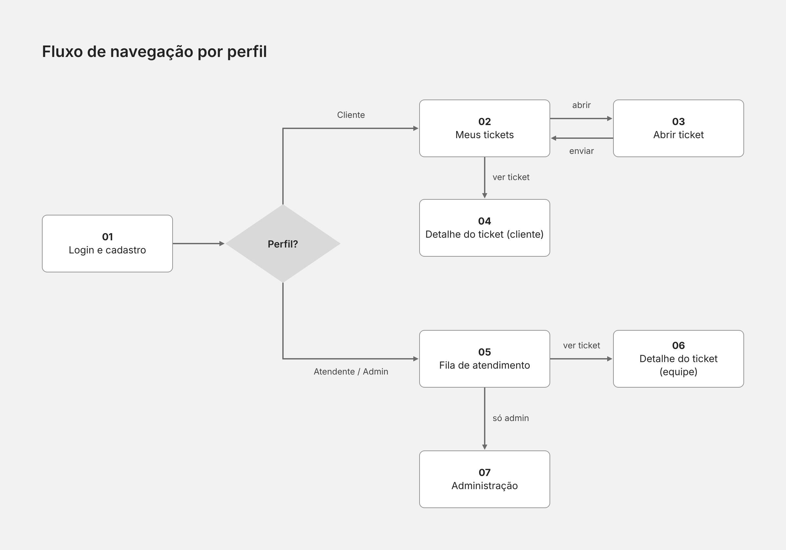
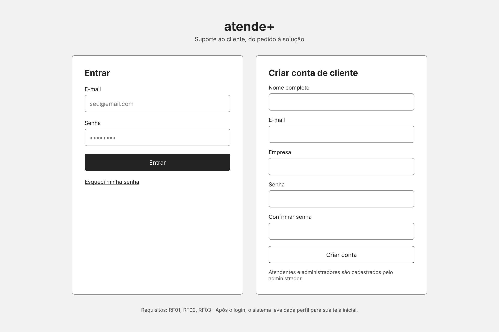
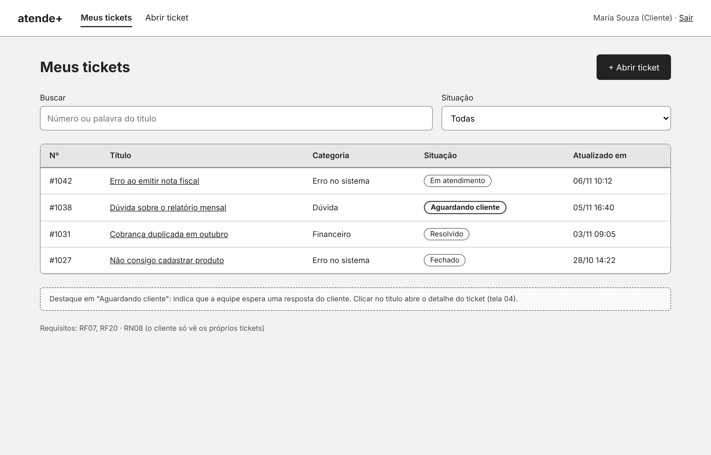
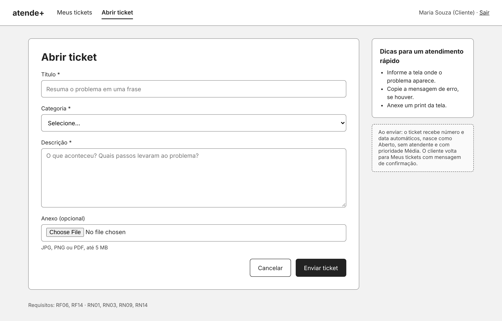
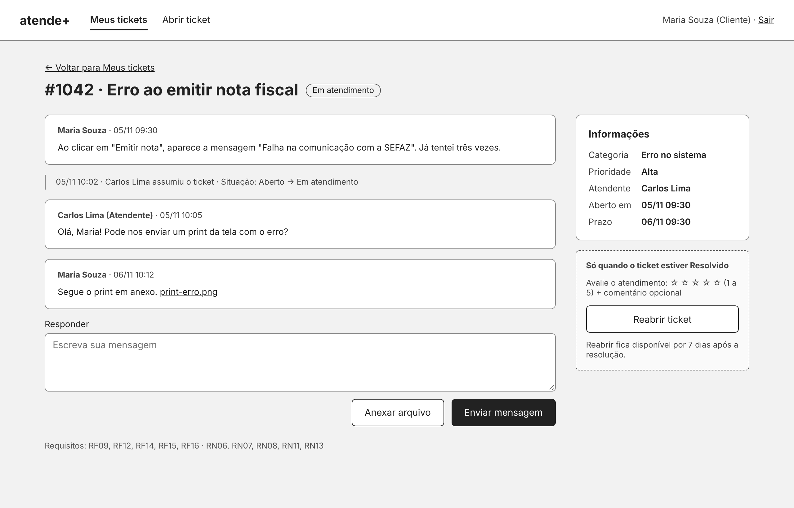
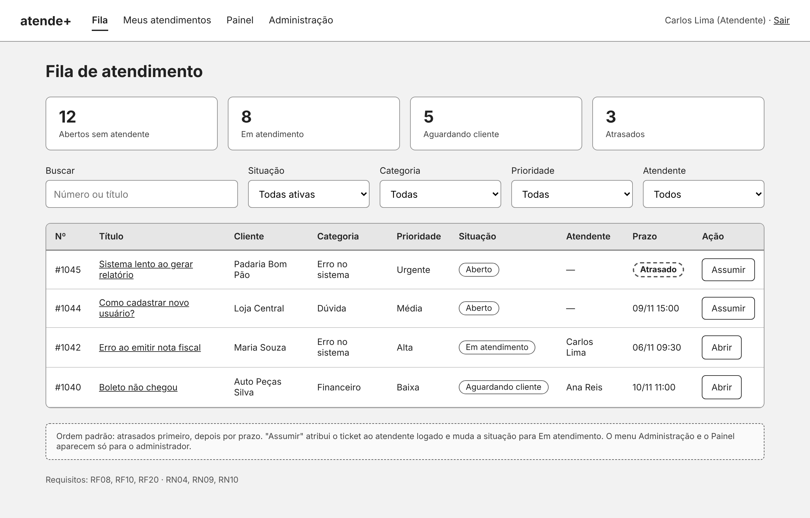
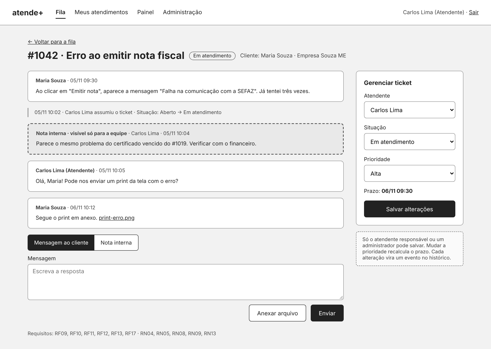
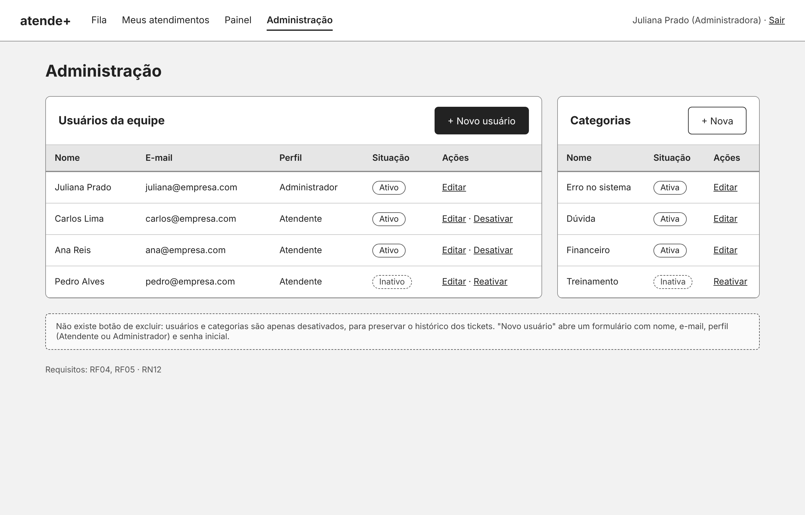

# Entrega 2 — Wireframes

Wireframes de baixa fidelidade do **atende+**: 7 telas e o fluxo de navegação entre elas.
São esboços em tons de cinza, sem identidade visual. Cores, tipografia e componentes
são definidos na Entrega 3 (protótipo navegável).

Nomes, números e tickets que aparecem nas telas são dados de exemplo.

## Fluxo de navegação

Depois do login, o sistema leva cada perfil para a sua tela inicial:
o **cliente** vai para *Meus tickets*; o **atendente** e o **administrador** vão para a *Fila de atendimento*.

## Telas

| Nº | Tela | Perfil | Requisitos | Regras de negócio |
| --- | --- | --- | --- | --- |
| 01 | [Login e cadastro](01-login-e-cadastro.png) | Todos | RF01, RF02, RF03 | — |
| 02 | [Meus tickets](02-meus-tickets.png) | Cliente | RF07, RF20 | RN08 |
| 03 | [Abrir ticket](03-abrir-ticket.png) | Cliente | RF06, RF14 | RN01, RN03, RN09, RN14 |
| 04 | [Detalhe do ticket (cliente)](04-detalhe-ticket-cliente.png) | Cliente | RF09, RF12, RF14, RF15, RF16 | RN06, RN07, RN08, RN11, RN13 |
| 05 | [Fila de atendimento](05-fila-de-atendimento.png) | Atendente, Administrador | RF08, RF10, RF20 | RN04, RN09, RN10 |
| 06 | [Detalhe do ticket (equipe)](06-detalhe-ticket-equipe.png) | Atendente, Administrador | RF09, RF10, RF11, RF12, RF13, RF17 | RN04, RN05, RN08, RN09, RN13 |
| 07 | [Administração](07-administracao.png) | Administrador | RF04, RF05 | RN12 |

Os códigos RF e RN se referem ao documento de requisitos da Entrega 1.

### 01 — Login e cadastro
Entrar com e-mail e senha, ou criar uma conta de cliente. Atendentes e administradores
não se cadastram sozinhos: são criados pelo administrador.

### 02 — Meus tickets
Lista dos tickets do cliente com busca e filtro por situação. "Aguardando cliente"
aparece em destaque, porque depende de uma resposta dele.

### 03 — Abrir ticket
Formulário com título, categoria, descrição e anexo opcional. O ticket nasce como
Aberto, sem atendente e com prioridade Média.

### 04 — Detalhe do ticket (cliente)
Histórico de mensagens e eventos, campo de resposta e informações do ticket.
Quando o ticket está Resolvido, aparecem a avaliação (1 a 5) e o botão de reabrir.

### 05 — Fila de atendimento
Contadores por situação, filtros e a lista de tickets. Atrasados aparecem primeiro.
"Assumir" atribui o ticket ao atendente logado.

### 06 — Detalhe do ticket (equipe)
Igual à visão do cliente, mais o painel para trocar atendente, situação e prioridade,
e a opção de escrever uma nota interna, que o cliente não vê.

### 07 — Administração
Gestão de usuários da equipe e de categorias. Não há exclusão: itens são desativados
para preservar o histórico.

