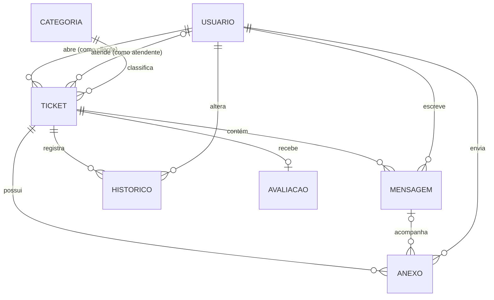
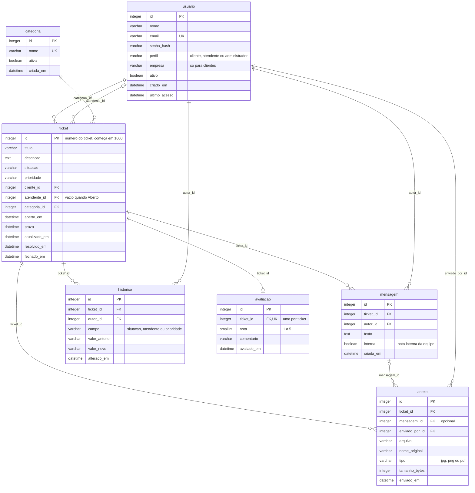

# Entrega 4 — Banco de dados

O atende+ guarda seus dados em **7 tabelas** num banco relacional **SQLite**: o banco inteiro é um único arquivo,
sem servidor para instalar, e o suporte a ele já vem com o Python e com o Django.
O modelo é independente do banco: o mesmo modelo também foi implementado e testado em **MariaDB/MySQL**,
que fica documentado como alternativa para um uso com muitos acessos simultâneos.
Nos dois bancos, o script foi testado com dados de exemplo e com 16 tentativas de dados inválidos (seção 6).

| Arquivo | Conteúdo |
| --- | --- |
| [`schema.sql`](schema.sql) | Modelo físico em SQLite: cria as tabelas, chaves, restrições e índices |
| [`dados-exemplo.sql`](dados-exemplo.sql) | Os mesmos usuários e tickets do protótipo da Entrega 3 (funciona nos dois bancos) |
| [`consultas-exemplo.sql`](consultas-exemplo.sql) | Consultas da fila, de Meus tickets e dos indicadores do painel, em SQLite |
| [`mariadb-mysql/`](mariadb-mysql/) | O mesmo modelo e as mesmas consultas para MariaDB 10.5+ ou MySQL 8.0.16+ |
| [`imagens/`](imagens/) | Os dois diagramas em PNG, para imprimir ou colar no relatório |

## 1. Modelo entidade-relacionamento (conceitual)

O centro do modelo é o **ticket**: ele pertence a um cliente, pode ter um atendente, tem uma categoria
e acumula mensagens, anexos, histórico e, no fim, uma avaliação.



Leitura dos relacionamentos (notação pé de galinha):

| Relacionamento | Cardinalidade | Significado |
| --- | --- | --- |
| Usuário **abre** ticket | 1 : N | Um cliente abre vários tickets; todo ticket tem exatamente um cliente. |
| Usuário **atende** ticket | 0..1 : N | Um atendente cuida de vários tickets; um ticket tem no máximo um atendente (RN04), e nenhum enquanto está Aberto (RN03). |
| Categoria **classifica** ticket | 1 : N | Toda categoria pode ter vários tickets; todo ticket tem uma categoria. |
| Ticket **contém** mensagem | 1 : N | A conversa do ticket. Cada mensagem tem um autor (cliente ou equipe). |
| Ticket **possui** anexo | 1 : N | Um anexo pode vir na abertura do ticket ou junto de uma mensagem (relação opcional com mensagem). |
| Ticket **registra** histórico | 1 : N | Cada mudança de situação, atendente ou prioridade vira um registro (RN13). |
| Ticket **recebe** avaliação | 1 : 0..1 | No máximo uma avaliação por ticket (RN11). |

## 2. Modelo lógico

Cada entidade virou uma tabela. **PK** é a chave primária, **FK** a chave estrangeira e **UK** um valor único.
Os tamanhos dos campos estão no dicionário de dados (seção 3).



### Decisões de modelagem

| Decisão | Alternativa descartada | Motivo |
| --- | --- | --- |
| SQLite como banco da aplicação | MariaDB/MySQL ou PostgreSQL | Não exige instalar nem configurar servidor: o professor e o servidor de publicação rodam o sistema só com o Python. O volume do atende+ (dezenas de usuários) está bem dentro do que o SQLite suporta. Trocar de banco no Django é uma configuração. |
| Uma tabela `usuario` com a coluna `perfil` | Tabelas separadas para cliente, atendente e administrador | Os três perfis fazem login do mesmo jeito e têm quase os mesmos dados. Uma tabela simplifica o login e as chaves estrangeiras. |
| `empresa` como texto em `usuario` | Tabela `empresa` própria | O sistema não gerencia empresas (fora do escopo). Se dois clientes forem da mesma empresa, o nome se repete: uma desnormalização aceita para manter o modelo simples. |
| `situacao` e `prioridade` como texto com `CHECK` | Tabelas de domínio | As listas são fixas pelas regras RN02 e RN09; mudar uma delas exige mudar o código de qualquer forma. |
| `prazo` gravado no ticket | Calcular na consulta | A fila ordena por prazo o tempo todo; gravado, ele pode ter índice. Muda junto com a prioridade (RN09). |
| `historico` separado de `mensagem` | Gravar mudanças como mensagens | Mudanças são estruturadas (campo, antes, depois), o que permite filtrar e gerar indicadores. |
| `avaliacao` em tabela própria | Colunas `nota` e `comentario` no ticket | A restrição `UNIQUE` garante a RN11 no banco, e o ticket não carrega colunas vazias na maioria das linhas. |
| Nada é excluído | `DELETE` com cascata | RN12: usuários e categorias são desativados. As chaves estrangeiras sem cascata impedem apagar alguém que tem tickets. |

O modelo está na **terceira forma normal (3FN)**, com exceção consciente da coluna `empresa`.

## 3. Dicionário de dados

Convenções: nomes em português, minúsculos e com `_`; chave primária sempre `id`; chave estrangeira sempre `<tabela>_id`.
Datas são gravadas em UTC, como faz o Django, e mostradas no horário de Brasília.

Os tipos seguem o padrão SQL. No SQLite, eles funcionam assim:

- `VARCHAR(n)`: o SQLite guarda como texto e não impõe o tamanho `n`; o Django valida o tamanho antes de gravar.
- `BOOLEAN`: guardado como 0 (falso) ou 1 (verdadeiro).
- `DATETIME`: guardado como texto no formato `AAAA-MM-DD HH:MM:SS`, o que permite comparar e ordenar datas.
- Chaves estrangeiras: só são verificadas com `PRAGMA foreign_keys = ON`, que o Django liga automaticamente.

### usuario
Pessoas que usam o sistema: clientes, atendentes e administradores.

| Coluna | Tipo | Nulo | Chave | Padrão | Descrição |
| --- | --- | --- | --- | --- | --- |
| id | INTEGER | Não | PK | automático | Identificador do usuário |
| nome | VARCHAR(150) | Não | | | Nome completo |
| email | VARCHAR(254) | Não | UK | | E-mail usado no login; não pode se repetir |
| senha_hash | VARCHAR(128) | Não | | | Senha criptografada pelo Django (RNF03) |
| perfil | VARCHAR(13) | Não | | | `cliente`, `atendente` ou `administrador` |
| empresa | VARCHAR(150) | Sim | | | Empresa do cliente; obrigatória quando o perfil é `cliente` |
| ativo | BOOLEAN | Não | | TRUE | FALSE impede o login (RN12) |
| criado_em | DATETIME | Não | | data atual | Data do cadastro |
| ultimo_acesso | DATETIME | Sim | | | Data do último login |

### categoria
Assuntos em que os tickets são classificados.

| Coluna | Tipo | Nulo | Chave | Padrão | Descrição |
| --- | --- | --- | --- | --- | --- |
| id | INTEGER | Não | PK | automático | Identificador da categoria |
| nome | VARCHAR(60) | Não | UK | | Ex.: Erro no sistema, Dúvida, Financeiro |
| ativa | BOOLEAN | Não | | TRUE | FALSE esconde a categoria na abertura de novos tickets (RN12) |
| criada_em | DATETIME | Não | | data atual | Data de criação |

### ticket
O pedido de suporte de um cliente.

| Coluna | Tipo | Nulo | Chave | Padrão | Descrição |
| --- | --- | --- | --- | --- | --- |
| id | INTEGER | Não | PK | automático, a partir de 1000 | Número do ticket exibido como #1042 (RN01). Um número usado nunca é reaproveitado |
| titulo | VARCHAR(120) | Não | | | Resumo do problema em uma frase |
| descricao | TEXT | Não | | | Descrição completa feita pelo cliente |
| situacao | VARCHAR(18) | Não | | `aberto` | `aberto`, `em_atendimento`, `aguardando_cliente`, `resolvido` ou `fechado` (RN02) |
| prioridade | VARCHAR(7) | Não | | `media` | `urgente`, `alta`, `media` ou `baixa` (RN09) |
| cliente_id | INTEGER | Não | FK → usuario | | Quem abriu o ticket |
| atendente_id | INTEGER | Sim | FK → usuario | | Atendente responsável; vazio se e somente se a situação é `aberto` (RN03, RN04) |
| categoria_id | INTEGER | Não | FK → categoria | | Assunto do ticket |
| aberto_em | DATETIME | Não | | data atual | Data e hora de abertura (RN01) |
| prazo | DATETIME | Não | | | Limite para resolver: abertura + 4 h, 1, 3 ou 5 dias, conforme a prioridade (RN09) |
| atualizado_em | DATETIME | Não | | data atual | Última mensagem ou mudança; ordena Meus tickets |
| resolvido_em | DATETIME | Sim | | | Quando foi resolvido; obrigatório nas situações `resolvido` e `fechado` |
| fechado_em | DATETIME | Sim | | | Quando foi fechado; obrigatório na situação `fechado` (RN07) |

### mensagem
A conversa do ticket.

| Coluna | Tipo | Nulo | Chave | Padrão | Descrição |
| --- | --- | --- | --- | --- | --- |
| id | INTEGER | Não | PK | automático | Identificador da mensagem |
| ticket_id | INTEGER | Não | FK → ticket | | Ticket da conversa |
| autor_id | INTEGER | Não | FK → usuario | | Quem escreveu |
| texto | TEXT | Não | | | Conteúdo; não pode ser vazio nem só espaços |
| interna | BOOLEAN | Não | | FALSE | TRUE para nota interna, nunca exibida ao cliente (RN08) |
| criada_em | DATETIME | Não | | data atual | Data e hora do envio |

### anexo
Arquivos enviados no ticket.

| Coluna | Tipo | Nulo | Chave | Padrão | Descrição |
| --- | --- | --- | --- | --- | --- |
| id | INTEGER | Não | PK | automático | Identificador do anexo |
| ticket_id | INTEGER | Não | FK → ticket | | Ticket ao qual o arquivo pertence |
| mensagem_id | INTEGER | Sim | FK → mensagem | | Mensagem que trouxe o arquivo; vazio se veio na abertura do ticket |
| enviado_por_id | INTEGER | Não | FK → usuario | | Quem enviou |
| arquivo | VARCHAR(255) | Não | | | Caminho do arquivo no servidor |
| nome_original | VARCHAR(255) | Não | | | Nome do arquivo no computador de quem enviou |
| tipo | VARCHAR(4) | Não | | | `jpg`, `png` ou `pdf` (RN14) |
| tamanho_bytes | INTEGER | Não | | | Tamanho do arquivo; máximo de 5.242.880 bytes (5 MB, RN14) |
| enviado_em | DATETIME | Não | | data atual | Data e hora do envio |

### historico
Registro automático das mudanças do ticket (RN13).

| Coluna | Tipo | Nulo | Chave | Padrão | Descrição |
| --- | --- | --- | --- | --- | --- |
| id | INTEGER | Não | PK | automático | Identificador do registro |
| ticket_id | INTEGER | Não | FK → ticket | | Ticket alterado |
| autor_id | INTEGER | Não | FK → usuario | | Quem fez a mudança |
| campo | VARCHAR(10) | Não | | | `situacao`, `atendente` ou `prioridade` |
| valor_anterior | VARCHAR(150) | Sim | | | Valor antes da mudança; vazio se não havia (ex.: sem atendente) |
| valor_novo | VARCHAR(150) | Sim | | | Valor depois da mudança; precisa ser diferente do anterior |
| alterado_em | DATETIME | Não | | data atual | Data e hora da mudança |

### avaliacao
Nota dada pelo cliente depois que o ticket é resolvido (RF16).

| Coluna | Tipo | Nulo | Chave | Padrão | Descrição |
| --- | --- | --- | --- | --- | --- |
| id | INTEGER | Não | PK | automático | Identificador da avaliação |
| ticket_id | INTEGER | Não | FK → ticket, UK | | Ticket avaliado; só uma avaliação por ticket (RN11) |
| nota | SMALLINT | Não | | | De 1 a 5 |
| comentario | VARCHAR(500) | Sim | | | Comentário opcional do cliente |
| avaliado_em | DATETIME | Não | | data atual | Data da avaliação |

## 4. Onde cada regra de negócio é garantida

| Regra | No banco (`schema.sql`) | Na aplicação (Django) |
| --- | --- | --- |
| RN01 Número sequencial | `AUTOINCREMENT` começando em 1000 | — |
| RN02 Situações possíveis | `ck_ticket_situacao` | Lista de opções nos formulários |
| RN03 / RN04 Aberto sem atendente | `ck_ticket_atendente` | Botão Assumir muda os dois campos juntos |
| RN05 Quem pode mudar a situação | — | Verificação de permissão por perfil |
| RN06 Volta para Em atendimento | — | Ao gravar mensagem do cliente |
| RN07 Reabrir em até 7 dias | `ck_ticket_resolvido`, `ck_ticket_fechado` | Prazo de 7 dias e fechamento automático |
| RN08 Cliente só vê o que é dele | Coluna `interna` | Filtro por cliente e por `interna` em todas as consultas |
| RN09 Prazo pela prioridade | `ck_ticket_prioridade`, `ck_ticket_prazo` | Cálculo do prazo |
| RN10 Atrasado | Índice `ix_ticket_situacao_prazo` | Comparação do prazo com a hora atual |
| RN11 Uma avaliação, de 1 a 5 | `uq_avaliacao_ticket`, `ck_avaliacao_nota` | Formulário só aparece em tickets resolvidos |
| RN12 Desativar em vez de excluir | Colunas `ativo` / `ativa`; FKs sem cascata | Telas sem botão de excluir |
| RN13 Histórico de mudanças | Tabela `historico`, `ck_historico_mudou` | Grava o registro a cada mudança |
| RN14 Anexos JPG, PNG ou PDF até 5 MB | `ck_anexo_tipo`, `ck_anexo_tamanho` | Validação no envio do arquivo |

## 5. Como criar o banco

No sistema final, quem cria as tabelas é o Django, com `python manage.py migrate`, a partir deste mesmo modelo.
Os scripts servem para documentar e validar o modelo, e podem ser rodados à parte.

**SQLite (oficial).** Nesta pasta, com o [SQLite](https://sqlite.org/download.html) instalado:

```bash
sqlite3 atende_mais.db ".read schema.sql" ".read dados-exemplo.sql"
sqlite3 -header -column atende_mais.db ".read consultas-exemplo.sql"
```

Sem o programa `sqlite3`, dá para usar só o Python, que já traz o SQLite:

```bash
python -c "import sqlite3; c=sqlite3.connect('atende_mais.db'); [c.executescript(open(f, encoding='utf-8').read()) for f in ('schema.sql','dados-exemplo.sql')]; c.commit()"
```

Para ver as tabelas com o mouse, o programa gratuito [DB Browser for SQLite](https://sqlitebrowser.org/) abre o arquivo `atende_mais.db`.

**MariaDB ou MySQL (alternativa).** Na pasta `mariadb-mysql/`:

```bash
mysql -u root -p -e "CREATE DATABASE atende_mais CHARACTER SET utf8mb4 COLLATE utf8mb4_unicode_ci;"
mysql -u root -p atende_mais < schema.sql
mysql -u root -p atende_mais < ../dados-exemplo.sql
mysql -u root -p atende_mais < consultas-exemplo.sql
```

No MariaDB, o comando `mysql` também se chama `mariadb`.

## 6. Testes do modelo

Depois de carregar os dados de exemplo, tentamos gravar dados que quebram as regras.
O teste foi feito no **SQLite 3.53** e no **MariaDB 10.11**, e os dois bancos recusaram todas as tentativas:

| Tentativa | Recusada por |
| --- | --- |
| Cliente sem empresa | `ck_usuario_empresa` |
| E-mail já cadastrado | `uq_usuario_email` |
| Perfil "gerente" | `ck_usuario_perfil` |
| Situação "pausado" | `ck_ticket_situacao` |
| Ticket Aberto já com atendente | `ck_ticket_atendente` |
| Em atendimento sem atendente | `ck_ticket_atendente` |
| Resolvido sem data de resolução | `ck_ticket_resolvido` |
| Prazo antes da abertura | `ck_ticket_prazo` |
| Ticket de cliente inexistente | `fk_ticket_cliente` (chave estrangeira) |
| Mensagem só com espaços | `ck_mensagem_texto` |
| Anexo .exe | `ck_anexo_tipo` |
| Anexo de 6 MB | `ck_anexo_tamanho` |
| Nota 6 | `ck_avaliacao_nota` |
| Segunda avaliação no mesmo ticket | `uq_avaliacao_ticket` |
| Histórico sem mudança real | `ck_historico_mudou` |
| Excluir cliente que tem tickets | `fk_ticket_cliente` (chave estrangeira) |

As consultas de `consultas-exemplo.sql` retornaram o esperado. Por exemplo, a fila mostrou o ticket #1006
(urgente, prazo vencido) em primeiro lugar, e a cliente Maria Souza viu apenas os próprios 4 tickets,
sem a nota interna do ticket #1003.
