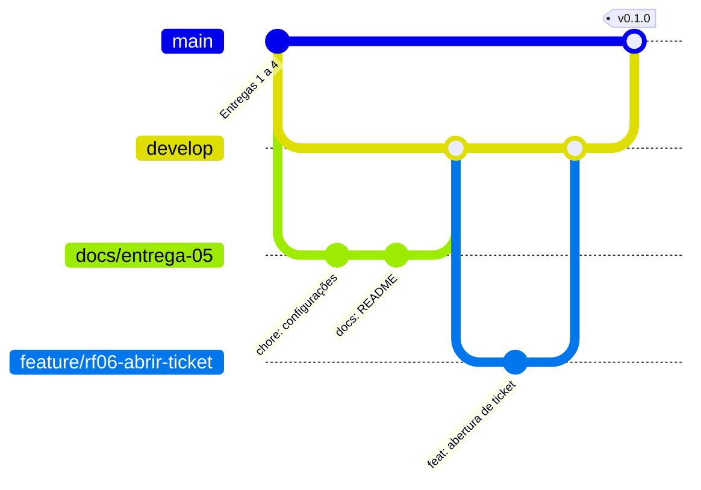

# Entrega 5 — Repositório e versionamento

O código e a documentação do atende+ ficam em um repositório Git hospedado no GitHub:
**https://github.com/natcurti/projeto_atende_mais** (público).

Esta entrega define como o repositório é organizado: as branches, o padrão das mensagens de commit,
o fluxo de trabalho com *pull requests* e a numeração das versões.

## 1. Configuração do repositório

| Item | Configuração |
| --- | --- |
| Hospedagem | GitHub, repositório público |
| Branch principal | `main` |
| Publicação | GitHub Pages servindo a pasta `docs/` da `main` (protótipo da Entrega 3) |
| `.gitignore` | Ignora o banco SQLite, o arquivo `.env` com segredos, os anexos enviados (`media/`), o ambiente virtual e arquivos de editores |
| `.gitattributes` | Padroniza as quebras de linha em LF, para o projeto funcionar igual no Windows e no Linux |
| `.editorconfig` | Codificação UTF-8 e indentação de 4 espaços em Python e de 2 em HTML, CSS e JavaScript |
| Modelo de PR | `.github/pull_request_template.md`: roteiro do que descrever ao abrir um pull request |

## 2. Branches

O projeto segue uma versão simplificada do **Git Flow**:

| Branch | Para que serve | Recebe mudanças de |
| --- | --- | --- |
| `main` | Versões estáveis, que vão para a avaliação e para o deploy. Cada checkpoint vira uma *tag* | `develop`, por pull request |
| `develop` | Integração: junta as tarefas prontas antes de virarem versão | branches de tarefa, por pull request |
| `feature/<rf>-<descrição>` | Uma funcionalidade nova. Ex.: `feature/rf06-abrir-ticket` | — |
| `fix/<descrição>` | Correção de um problema. Ex.: `fix/prazo-ticket-urgente` | — |
| `docs/<descrição>` | Só documentação. Ex.: `docs/entrega-06-arquitetura` | — |

Regras:

- Ninguém faz commit direto na `main` nem na `develop`: tudo entra por pull request.
- Cada branch de tarefa nasce da `develop` atualizada e é apagada depois de juntada.
- Nomes de branch em minúsculas, sem acentos, com palavras separadas por `-`.



O diagrama mostra o caminho de uma mudança: ela nasce numa branch de tarefa, é juntada na `develop`
e, quando um conjunto de tarefas forma uma versão, a `develop` é juntada na `main` com uma tag.

## 3. Mensagens de commit

As mensagens seguem o padrão **[Conventional Commits](https://www.conventionalcommits.org/pt-br/v1.0.0/)**, escritas em português:

```
<tipo>(<escopo opcional>): <descrição no presente, em minúsculas, sem ponto final>

<corpo opcional: o porquê da mudança>
```

| Tipo | Quando usar | Exemplo |
| --- | --- | --- |
| `feat` | Nova funcionalidade | `feat(tickets): permite ao cliente reabrir um ticket resolvido` |
| `fix` | Correção de erro | `fix(fila): ordena tickets atrasados antes dos demais` |
| `docs` | Só documentação | `docs(banco): adiciona dicionário de dados` |
| `test` | Testes automatizados | `test(tickets): cobre a regra de reabertura em 7 dias` |
| `refactor` | Melhoria de código sem mudar o comportamento | `refactor(tickets): extrai o cálculo de prazo para uma função` |
| `style` | Formatação, sem mudar lógica | `style: aplica formatação do black` |
| `chore` | Configuração e manutenção | `chore: adiciona configurações base do repositório` |

Cada commit faz **uma coisa só**. Se a descrição precisa de um "e", provavelmente são dois commits.

## 4. Fluxo de trabalho

Passo a passo para cada tarefa do backlog:

```bash
# 1. Atualizar a develop
git checkout develop
git pull

# 2. Criar a branch da tarefa
git checkout -b feature/rf06-abrir-ticket

# 3. Trabalhar e registrar commits pequenos
git add .
git commit -m "feat(tickets): cria formulário de abertura de ticket"

# 4. Enviar a branch para o GitHub
git push -u origin feature/rf06-abrir-ticket
```

5. No GitHub, abrir um **pull request** da branch para a `develop`, preenchendo o modelo.
6. Revisar as mudanças no próprio PR e, se estiver tudo certo, clicar em **Merge pull request**.
7. Apagar a branch da tarefa (o GitHub oferece o botão logo após o merge).

Ao fechar um checkpoint, abre-se um pull request da `develop` para a `main` e, depois do merge, cria-se a tag da versão.

## 5. Versões

As versões seguem o **[versionamento semântico](https://semver.org/lang/pt-BR/)** (`MAIOR.MENOR.CORREÇÃO`) e
cada checkpoint da disciplina vira uma tag na `main`:

| Checkpoint | Tag | Conteúdo esperado |
| --- | --- | --- |
| 2 — MVP funcional | `v0.1.0` | Requisitos essenciais (RF01, RF02, RF04 a RF12) |
| 3 — Evolução | `v0.2.0` | RF13, RF15, RF17, RF20 |
| 4 — Nova versão | `v0.3.0` | RF16, RF18 |
| 5 — Release candidate | `v1.0.0-rc.1` | Funcionalidades concluídas e bugs corrigidos |
| Entrega final | `v1.0.0` | Versão avaliada |

Correções entre checkpoints aumentam o último número (ex.: `v0.1.1`).

## 6. Configurando o repositório na sua máquina

Uma vez só, depois de instalar o [Git](https://git-scm.com/):

```bash
git config --global user.name "Seu Nome"
git config --global user.email "seu-email-do-github@exemplo.com"
git config --global core.autocrlf input   # no Windows: evita converter quebras de linha

git clone https://github.com/natcurti/projeto_atende_mais.git
cd projeto_atende_mais
git checkout develop
```

## 7. Histórico até aqui

As Entregas 1 a 4 foram commitadas direto na `main`, antes de existir o modelo de branches.
Esta entrega foi a primeira a seguir o fluxo completo: a branch `docs/entrega-05-repositorio` saiu da `develop`,
foi juntada por pull request e a `develop` foi levada à `main` também por pull request.

Uma lição registrada: no início, a mensagem de um commit já enviado foi corrigida com `git commit --amend`
e `git push --force`. Isso reescreve o histórico do GitHub e só foi seguro porque ninguém mais tinha baixado o
repositório. Daqui em diante, correções entram como novos commits.
