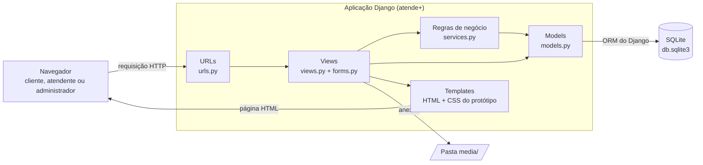

# Entrega 6 — Arquitetura e padrões de desenvolvimento

O atende+ é uma **aplicação web monolítica em Django**: um único programa recebe as requisições do navegador,
aplica as regras de negócio, consulta o banco **SQLite** e devolve páginas HTML prontas.
Esta entrega descreve as camadas, a organização do código, as tecnologias e os padrões adotados.
O esqueleto do projeto, que segue esta arquitetura, está na raiz do repositório.

## 1. Visão geral



Uma requisição percorre este caminho: o navegador pede um endereço, o arquivo `urls.py` decide qual
**view** atende, a view valida os dados com um **form**, aplica as regras de negócio (em `services.py`),
lê ou grava pelos **models**, e devolve um **template** HTML preenchido.

A escolha por páginas montadas no servidor (em vez de uma API e um front-end separado em React, por exemplo)
mantém uma só linguagem, um só projeto e um só deploy, o que cabe no tamanho e no prazo do projeto.

## 2. Camadas

O Django organiza o código no padrão **MVT (Model, View, Template)**, a versão do Django para o MVC.
Acrescentamos uma camada de serviços para as regras de negócio:

| Camada | Onde fica | Responsabilidade | Exemplo no atende+ |
| --- | --- | --- | --- |
| Apresentação | `templates/`, `static/` | Mostrar as telas; nenhuma regra de negócio | Lista de Meus tickets, com o CSS do protótipo |
| Controle | `urls.py`, `views.py`, `forms.py` | Receber a requisição, validar a entrada, verificar a permissão, chamar a regra e escolher a resposta | View de abertura de ticket |
| Regras de negócio | `services.py` | As regras RN01 a RN14 que envolvem mais de um dado ou etapa | Calcular o prazo (RN09), assumir um ticket e registrar o histórico (RN04, RN13) |
| Dados | `models.py` + ORM | Estrutura das tabelas e restrições do banco | `Ticket`, com as restrições da Entrega 4 |

A regra prática: **views finas, regras em serviços**. A view não decide sozinha, por exemplo,
para qual situação o ticket vai; ela chama um serviço que faz isso. Assim, a regra é testada uma vez
e vale para todas as telas que a usam.

## 3. Organização do código

O projeto é dividido em *apps* do Django, cada uma cuidando de uma parte do domínio:

| App | Responsabilidade | Requisitos |
| --- | --- | --- |
| `contas` | Usuário com perfis, cadastro, login e administração da equipe | RF01 a RF04 |
| `tickets` | Categorias, tickets, mensagens, anexos, histórico, avaliação, fila e regras de atendimento | RF05 a RF17, RF20 |
| `painel` (depois do MVP) | Indicadores e exportação em CSV | RF18, RF21 |

```
projeto_atende_mais/
├── manage.py               comando de administração do Django
├── requirements.txt        dependências do projeto
├── .env.exemplo            modelo das configurações locais (sem segredos)
├── config/                 configuração do projeto
│   ├── settings.py
│   └── urls.py             rotas principais
├── contas/                 app de usuários
│   ├── models.py           Usuario (modelo de usuário próprio)
│   ├── managers.py         criação de usuários e administradores
│   ├── admin.py
│   └── tests.py
├── tickets/                app de atendimento
│   ├── models.py           Categoria, Ticket, Mensagem, Anexo, Historico, Avaliacao
│   ├── services.py         regras de negócio
│   ├── admin.py
│   ├── management/commands/carregar_dados_exemplo.py
│   ├── migrations/
│   └── tests.py
├── templates/              HTML: base.html e as telas
├── static/                 CSS e JavaScript (vindos do protótipo)
└── docs/                   documentação das entregas
```

## 4. Tecnologias

| Tecnologia | Versão | Uso | Por que |
| --- | --- | --- | --- |
| Python | 3.10 a 3.13 (recomendado 3.12+) | Linguagem | Exigida pelo Django; ensinada no curso |
| Django | 5.2 LTS | Framework web | Já traz login, senhas criptografadas, ORM, formulários, administração e testes. A versão LTS tem correções até abril de 2028 |
| SQLite | 3 (vem com o Python) | Banco de dados | Arquivo único, sem servidor (decisão da Entrega 4) |
| python-dotenv | 1.x | Configuração | Lê as configurações locais do arquivo `.env` |
| HTML, CSS e JavaScript | — | Interface | Reaproveita o protótipo da Entrega 3 |
| Atkinson Hyperlegible | Google Fonts | Fonte | Definida no guia de estilo |
| Git e GitHub | — | Versionamento | Fluxo da Entrega 5 |
| PythonAnywhere | plano gratuito | Publicação | Roda Django com SQLite sem custo (RNF10) |

## 5. Padrões adotados

### Código

- **PEP 8** para o estilo do Python: 4 espaços, nomes em `snake_case`, classes em `PascalCase`.
- **Nomes do domínio em português**, como `Ticket.situacao` e `calcular_prazo()`. Nomes exigidos pelo Django ficam em inglês, como `password`, `is_active` e `objects`.
- **Opções fixas como `TextChoices`**: situação, prioridade e perfil são enumerações no código, iguais às restrições `CHECK` do banco.

### Django

| Padrão | Como é aplicado |
| --- | --- |
| Modelo de usuário próprio | `contas.Usuario` substitui o usuário padrão do Django: o login é pelo e-mail, e o usuário tem `perfil` e `empresa`. Definido antes da primeira migração, como recomenda a documentação do Django |
| Restrições no model | As restrições da Entrega 4 são declaradas em `Meta.constraints` e criadas pelo `migrate`, para valerem em qualquer banco |
| Camada de serviços | Regras de negócio em `services.py`, chamadas pelas views e testadas separadamente |
| Post/Redirect/Get | Depois de gravar um formulário, a view redireciona para outra página, e o aviso de confirmação vem do *messages framework* (os avisos verdes do protótipo). Recarregar a página não reenvia o formulário |
| Herança de templates | Todas as telas estendem `base.html`, que tem o topo, o menu e a área de avisos |
| Permissão por perfil | Cada view declara quais perfis podem acessá-la, e o cliente só consulta os próprios tickets (RN05, RN08, RNF04) |
| Configuração por ambiente | Segredos e opções de cada máquina ficam no `.env`, nunca no código. Sem `.env`, o projeto roda em modo de desenvolvimento |

### Testes

- Testes automatizados com o **test runner do Django** (`python manage.py test`), sem ferramentas extras.
- Cada regra de negócio de `services.py` e cada restrição dos models tem pelo menos um teste.
- O plano completo de testes é a Entrega 8.

### Versionamento

Branches, mensagens de commit e versões seguem a [Entrega 5](../05-repositorio/).

## 6. Do modelo de dados para o Django

As 7 tabelas da Entrega 4 viram models com os mesmos nomes de tabela e de coluna.
As únicas adaptações vêm do sistema de login do Django:

| Entrega 4 (`usuario`) | Model `Usuario` | Observação |
| --- | --- | --- |
| `senha_hash` | `password` | Nome exigido pelo Django; a coluna continua `senha_hash` |
| `ultimo_acesso` | `last_login` | Atualizado pelo Django a cada login; a coluna continua `ultimo_acesso` |
| `ativo` | `is_active` | Usuário inativo não entra (RN12); a coluna continua `ativo` |
| — | `is_superuser` | Coluna nova: marca quem acessa a área de administração técnica do Django |

O Django também cria tabelas próprias para sessões de login, permissões e controle das migrações.
Elas ficam à parte das 7 tabelas do domínio.

## 7. Segurança

| Requisito | Como é atendido |
| --- | --- |
| RNF03 — Senhas com hash | O Django guarda as senhas com PBKDF2 e um "sal" aleatório; a senha original nunca é gravada |
| RNF04 — Acesso por perfil | Login obrigatório e verificação de perfil em cada view; consultas filtradas pelo usuário logado |
| Formulários | Proteção CSRF do Django em todos os formulários e validação no servidor, mesmo com a validação do navegador |
| Injeção de SQL | Todas as consultas passam pelo ORM, que trata os valores digitados |
| Segredos | `SECRET_KEY` e configurações de produção no `.env`, que não vai para o repositório |
| Anexos | Tipo e tamanho verificados antes de gravar (RN14); arquivos fora da pasta de código |

## 8. Ambientes e publicação

| Ambiente | Onde | Banco | Configuração |
| --- | --- | --- | --- |
| Desenvolvimento | Máquina da equipe e do professor | `db.sqlite3` na pasta do projeto | Sem `.env`: `DEBUG` ligado |
| Produção | PythonAnywhere, plano gratuito | `db.sqlite3` no servidor | `.env` com `DEBUG` desligado, `SECRET_KEY` própria e o endereço do site |

O código é o mesmo nos dois ambientes; só muda o `.env`.

## 9. Decisões de arquitetura

| Decisão | Alternativa considerada | Motivo |
| --- | --- | --- |
| Monolito Django com páginas no servidor | API REST + front-end em React | Uma linguagem, um projeto e um deploy; o protótipo HTML/CSS vira template quase direto |
| Django | Flask, FastAPI | O Django já inclui login, ORM, formulários, administração e testes, que o atende+ usa em quase todos os requisitos |
| Django 5.2 LTS | Django 6.1, a versão mais nova | Suporte até abril de 2028 e compatível com mais versões do Python, o que facilita rodar em qualquer máquina |
| SQLite | MariaDB, MySQL | Sem instalação; o modelo também roda em MariaDB/MySQL, se necessário (Entrega 4) |
| Duas apps (`contas`, `tickets`) | Uma app só, ou uma por tabela | Separa o que é de usuário do que é de atendimento, sem fragmentar demais |
| Regras em `services.py` | Regras dentro das views ou dos models | Views ficam simples e as regras ficam num lugar só, fáceis de testar |
| Área de administração do Django só para manutenção técnica | Usar o admin do Django como tela do administrador | As telas do administrador seguem o protótipo; o admin do Django serve para conferir dados durante o desenvolvimento |
