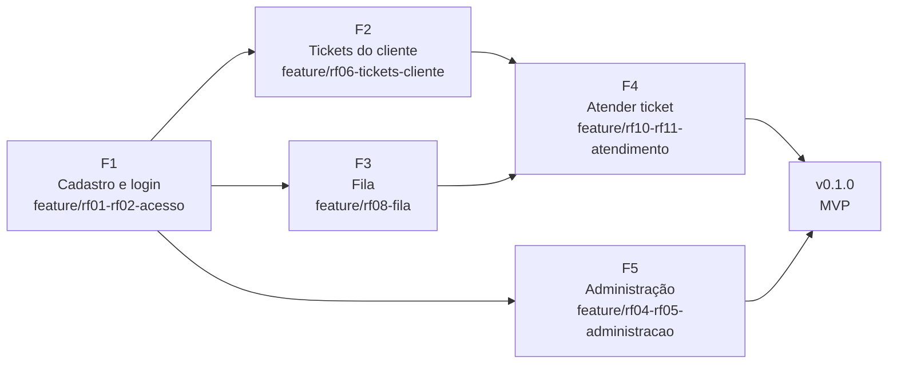

# Checkpoint 1 — Definição do MVP

O MVP (produto mínimo viável) do atende+ cobre o **ciclo completo de um ticket**: o cliente se cadastra, abre um
ticket e conversa com a equipe; o atendente pega o ticket na fila, responde e marca como resolvido; o administrador
mantém a equipe e as categorias. É a menor versão que já resolve o problema principal da Entrega 1:
**pedidos de suporte centralizados, com responsável, situação e histórico**.

O MVP vira a versão `v0.1.0` na `main` e é apresentado no Checkpoint 2.

> **Situação:** todos os 27 critérios de aceite abaixo foram atendidos. O resultado está em [docs/09-mvp-funcional](../09-mvp-funcional/).

## 1. Requisitos priorizados

A prioridade usa o método **MoSCoW**, a partir da prioridade definida na Entrega 1:

| Classe MoSCoW | Significado | Requisitos | Quando |
| --- | --- | --- | --- |
| **Must** (obrigatório) | Sem ele, o sistema não resolve o problema | RF01, RF02, RF04, RF05, RF06, RF07, RF08, RF09, RF10, RF11, RF12 | MVP (Checkpoint 2) |
| **Should** (importante) | Agrega muito valor, mas o ciclo funciona sem ele | RF13, RF15, RF17, RF20 | Evolução 1 (Checkpoint 3) |
| **Should** (importante) | Depende de tickets resolvidos para fazer sentido | RF16, RF18 | Evolução 2 (Checkpoint 4) |
| **Could** (desejável) | Entra se houver tempo | RF03, RF14, RF19, RF21 | Release (Checkpoint 5) |

Critérios usados para ordenar dentro de cada classe:

1. **Dependência:** o que outras funcionalidades precisam vem antes. Por exemplo, o login (RF02) vem antes de qualquer tela.
2. **Valor para o cliente:** abrir e acompanhar um ticket vem antes das ferramentas internas da equipe.
3. **Risco técnico:** o que tem mais regras de negócio (permissões, mudança de situação) é feito cedo, para sobrar tempo de corrigir.

## 2. Funcionalidades obrigatórias do MVP

As 11 funcionalidades obrigatórias foram agrupadas em 5 entregas menores. Cada uma tem critérios de aceite:
a funcionalidade só é considerada pronta quando todos eles passam.

### F1 — Cadastro, login e saída (RF01, RF02)

Tela: Entrada (protótipo, `index.html`).

- [x] O cliente cria a conta com nome, e-mail, empresa e senha; o e-mail não pode estar cadastrado (RF01).
- [x] A senha precisa ter pelo menos 8 caracteres e é guardada só como hash (RNF03).
- [x] Qualquer perfil entra com e-mail e senha; usuário desativado não entra (RN12).
- [x] Depois de entrar, o cliente vai para *Meus tickets* e a equipe vai para a *Fila* (navegação da Entrega 3).
- [x] Qualquer tela do sistema, se acessada sem login, leva para a tela de entrada.
- [x] O botão *Sair* encerra a sessão.

### F2 — Abrir e acompanhar tickets, pelo cliente (RF06, RF07, RF09, RF12)

Telas: Meus tickets, Abrir ticket e Ticket em atendimento (protótipo).

- [x] O cliente abre um ticket com título, categoria (só as ativas) e descrição (RF06, RN12).
- [x] O ticket nasce Aberto, sem atendente, com número a partir de 1000 e prazo de prioridade Média (RN01, RN03, RN09).
- [x] Depois de enviar, o cliente volta para *Meus tickets* com o aviso de confirmação.
- [x] *Meus tickets* lista só os tickets do próprio cliente, com número, título, categoria, situação e última atualização (RF07, RN08).
- [x] O detalhe mostra a conversa e os eventos do histórico, **sem as notas internas** (RF09, RN08).
- [x] O cliente responde no próprio ticket (RF12). Se o ticket estava *Aguardando cliente*, volta para *Em atendimento* (RN06).
- [x] Um cliente que tenta abrir o endereço do ticket de outro cliente recebe "página não encontrada" (RNF04).

### F3 — Fila de atendimento (RF08)

Tela: Fila (protótipo, `equipe-fila.html`).

- [x] Só atendentes e administradores acessam a fila (RNF04).
- [x] A fila mostra os tickets não resolvidos: atrasados primeiro, depois por prazo (RN10).
- [x] Os contadores do topo mostram quantos tickets há em cada situação.
- [x] Filtros por situação, categoria, prioridade e atendente (incluindo "Comigo" e "Sem atendente") funcionam juntos.

### F4 — Atender o ticket (RF09, RF10, RF11, RF12)

Tela: Ticket na visão da equipe (protótipo, `equipe-ticket.html`).

- [x] O atendente vê a conversa completa e responde ao cliente (RF09, RF12).
- [x] *Assumir* coloca o ticket com o atendente logado e muda para *Em atendimento* (RF10, RN04).
- [x] O administrador pode atribuir o ticket a outro atendente (RF10).
- [x] O atendente responsável ou um administrador muda a situação para *Aguardando cliente* ou *Resolvido*; os outros atendentes não podem (RF11, RN05).
- [x] *Resolvido* grava a data de resolução.
- [x] Toda mudança de atendente ou de situação aparece no histórico, com autor e data (RN13).

### F5 — Administração (RF04, RF05)

Tela: Administração (protótipo, `admin.html`).

- [x] Só administradores acessam (RNF04).
- [x] O administrador cadastra, edita, desativa e reativa atendentes e administradores (RF04, RN12).
- [x] O administrador cadastra, renomeia, desativa e reativa categorias (RF05, RN12).
- [x] Não há exclusão: itens desativados continuam aparecendo nos tickets antigos (RN12).

### Fora do MVP

Ficam para as próximas versões, conforme a tabela da seção 1:

- notas internas (RF13);
- reabrir ticket (RF15) e fechamento automático (RN07);
- mudar a prioridade (RF17): no MVP todo ticket tem prioridade Média;
- busca por número ou título (RF20);
- avaliação (RF16) e painel de indicadores (RF18);
- recuperação de senha, anexos, e-mails e exportação em CSV (RF03, RF14, RF19, RF21).

A estrutura do banco para todos eles **já existe** desde a Entrega 6. Eles só precisam das telas e das regras.

## 3. Plano de entrega

### Ordem de construção

Cada funcionalidade é uma branch que sai da `develop` e volta por pull request (fluxo da Entrega 5):

| Ordem | Funcionalidade | Branch | Depende de | O que entra no código |
| --- | --- | --- | --- | --- |
| 1 | F1 Cadastro e login | `feature/rf01-rf02-acesso` | esqueleto (Entrega 6) | Formulário de cadastro, telas de entrada e saída, redirecionamento por perfil, controle de acesso |
| 2 | F2 Tickets do cliente | `feature/rf06-tickets-cliente` | F1 | Formulário de abertura, Meus tickets, detalhe com resposta, serviço da RN06 |
| 3 | F3 Fila | `feature/rf08-fila` | F1 | Consulta da fila com filtros e ordenação, contadores |
| 4 | F4 Atender ticket | `feature/rf10-rf11-atendimento` | F2, F3 | Serviços de assumir, atribuir e mudar situação com histórico; permissões da RN05 |
| 5 | F5 Administração | `feature/rf04-rf05-administracao` | F1 | Telas de equipe e categorias |
| 6 | Versão do MVP | PR `develop` → `main` | F1 a F5 | Tag `v0.1.0` |

As telas reaproveitam o HTML e o CSS do protótipo da Entrega 3, já ligado ao Django pelo template `base.html`.

### Definição de pronto

Uma funcionalidade só entra na `develop` quando:

1. Todos os critérios de aceite da seção 2 foram conferidos no navegador.
2. As regras de negócio novas têm testes automatizados, e `python manage.py test` passa inteiro.
3. Cada tela funciona na largura de um celular (RNF06).
4. O pull request está descrito com o modelo do projeto e os commits seguem o padrão.
5. O README continua correto. Por exemplo, se um comando mudou, ele foi atualizado.

### Demonstração no Checkpoint 2

Roteiro previsto para a apresentação, com os dados de exemplo:

1. Maria (cliente) cria a conta, entra e abre o ticket "Erro ao emitir nota fiscal".
2. Carlos (atendente) vê o ticket na fila, com o urgente atrasado no topo, e assume o ticket.
3. Carlos pede um print e muda a situação para *Aguardando cliente*.
4. Maria responde; o ticket volta para *Em atendimento* sozinho (RN06).
5. Carlos marca como *Resolvido*; Maria vê a situação atualizada e o histórico completo.
6. Juliana (administradora) cadastra uma nova atendente e desativa uma categoria.

### Riscos

| Risco | Efeito | Como reduzir |
| --- | --- | --- |
| Erro de permissão (cliente vendo ticket de outro, atendente mudando ticket alheio) | Falha de segurança na demonstração | Testes automatizados de acesso para cada perfil em F2, F3 e F4 |
| Mudanças de situação inconsistentes | Ticket em situação impossível | Transições só pela camada de serviços, mais as restrições do banco que já existem |
| Pouco tempo até o checkpoint | MVP incompleto | Ordem por dependência: F1 a F4 já formam um ciclo demonstrável, mesmo que F5 atrase |
| Diferença entre a máquina da autora e a do professor | Sistema não roda na avaliação | O README foi testado com instalação do zero; repetir o teste antes de criar a tag |
