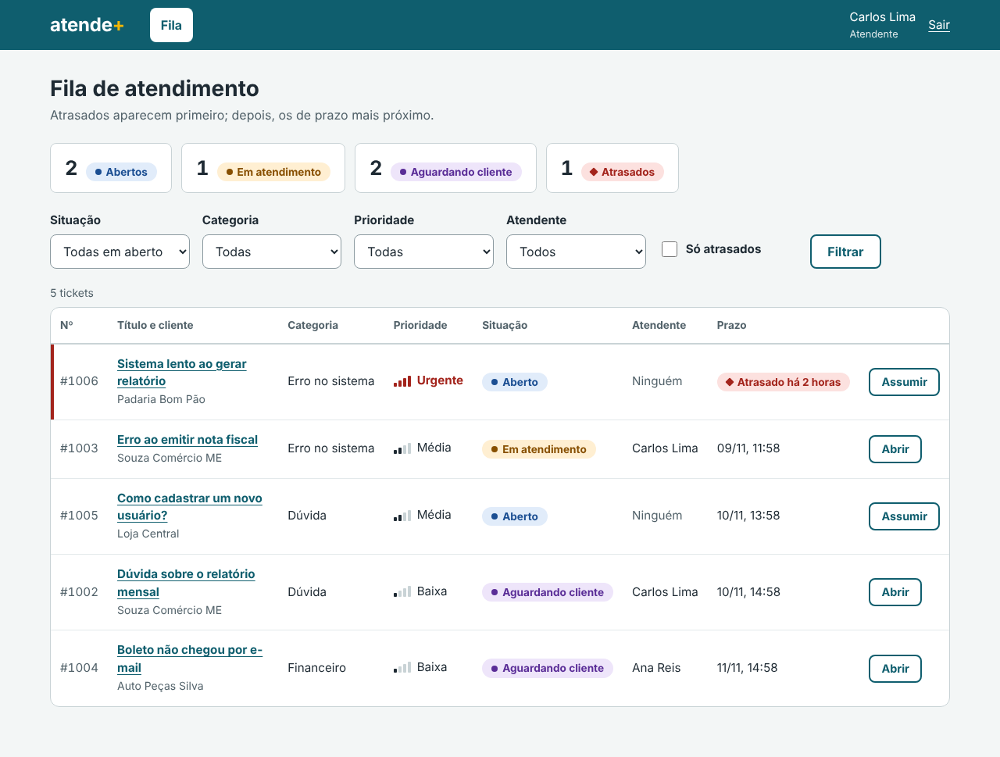
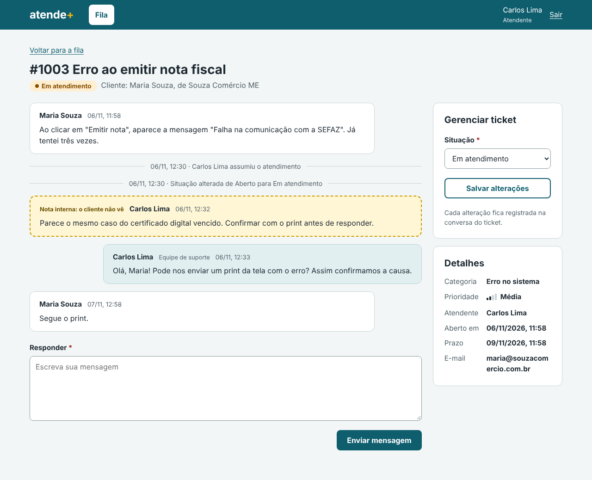

# Checkpoint 2 — MVP funcional

O MVP do atende+ está pronto na versão **`v0.1.0`**. O ciclo completo de um ticket funciona: a cliente se cadastra
e abre o ticket, o atendente assume e conversa com ela, pede informação, a cliente responde e o ticket é resolvido.
A administradora mantém a equipe e as categorias.

Os **11 requisitos obrigatórios** do MVP e os **27 critérios de aceite** definidos no [Checkpoint 1](../08-mvp/)
foram atendidos e são verificados por **111 testes automatizados**.

## 1. Telas

| Perfil | Tela | Captura |
| --- | --- | --- |
| Todos | Entrada: login e cadastro de cliente | [01-entrada](imagens/01-entrada.png) |
| Cliente | Meus tickets | [02-meus-tickets](imagens/02-meus-tickets.png) |
| Cliente | Abrir ticket | [03-abrir-ticket](imagens/03-abrir-ticket.png) |
| Cliente | Ticket com a conversa | [04-ticket-cliente](imagens/04-ticket-cliente.png) |
| Atendente e administrador | Fila de atendimento | [05-fila](imagens/05-fila.png) |
| Atendente e administrador | Ticket na visão da equipe | [06-ticket-equipe](imagens/06-ticket-equipe.png) |
| Administrador | Administração | [07-administracao](imagens/07-administracao.png) |
| Atendente (celular) | Fila de atendimento | [08-fila-celular](imagens/08-fila-celular.png) |
| Cliente (celular) | Ticket com a conversa | [09-ticket-cliente-celular](imagens/09-ticket-cliente-celular.png) |





## 2. Estado dos requisitos

### Funcionais

| Requisito | Situação | Onde |
| --- | --- | --- |
| RF01 Cadastro de cliente | Pronto | Tela de entrada |
| RF02 Entrar e sair | Pronto | Tela de entrada e botão *Sair* |
| RF04 Gerenciar atendentes e administradores | Pronto | Administração |
| RF05 Gerenciar categorias | Pronto | Administração |
| RF06 Abrir ticket | Pronto | Abrir ticket |
| RF07 Listar os próprios tickets | Pronto | Meus tickets |
| RF08 Fila com filtros | Pronto | Fila |
| RF09 Detalhe com histórico | Pronto | Ticket (cliente e equipe) |
| RF10 Assumir ou atribuir | Pronto | Fila e ticket da equipe |
| RF11 Alterar a situação | Pronto | Painel *Gerenciar ticket* |
| RF12 Mensagens no ticket | Pronto | Ticket (cliente e equipe) |
| RF13, RF15, RF17, RF20 | Próxima versão (Checkpoint 3) | — |
| RF16, RF18 | Checkpoint 4 | — |
| RF03, RF14, RF19, RF21 | Release candidate, se houver tempo | — |

O banco de dados já tem as tabelas de todas as funcionalidades futuras (anexos, avaliações, histórico de prioridade).
Elas só precisam das telas e das regras.

### Regras de negócio no MVP

| Regra | Como foi implementada |
| --- | --- |
| RN01 Número a partir de 1000 | Migração que inicia a numeração; `test_numeracao_comeca_em_1000` |
| RN02, RN03, RN04 Situações e atendente | Restrições no banco e serviço `assumir` |
| RN05 Só o responsável ou o administrador altera | Função `pode_atuar`, usada na resposta e na mudança de situação |
| RN06 Resposta do cliente tira de *Aguardando cliente* | Serviço `responder` |
| RN08 Cliente só vê o que é dele, sem notas internas | Consultas filtradas pelo cliente e `linha_do_tempo` |
| RN09 Prazo pela prioridade | Serviço `calcular_prazo`; no MVP, todo ticket nasce com prioridade Média |
| RN10 Atrasados primeiro | Serviço `fila_de_atendimento` |
| RN12 Desativar em vez de excluir | Pessoas e categorias; ninguém é excluído |
| RN13 Histórico de mudanças | Serviço `registrar_historico`, chamado em toda mudança |

### Não funcionais

| Requisito | Resultado |
| --- | --- |
| RNF01 Python e Django | Django 5.2 LTS |
| RNF02 Banco relacional | SQLite (decisão da Entrega 4) |
| RNF03 Senhas com hash | Senhas guardadas com PBKDF2 pelo Django; validação de tamanho, senhas comuns e só números |
| RNF04 Acesso por perfil | Cada tela declara os perfis permitidos; testes de acesso para os três perfis |
| RNF05 Abrir ticket em até 3 cliques | 2 cliques: menu *Abrir ticket* e botão *Enviar ticket* |
| RNF06 Funciona no celular | Testado em 390 px de largura: listas viram cartões, sem rolagem lateral |
| RNF07 Listas em até 2 segundos com 1.000 tickets | Medido com 1.007 tickets: fila em cerca de 10 ms (7 consultas ao banco, paginada) e Meus tickets em cerca de 100 ms |
| RNF09 Git, padrão de commits e README | Fluxo da Entrega 5: 10 pull requests até aqui |
| RNF08, RNF10 | Navegadores e publicação: na Entrega 8 e no Checkpoint 5 |

## 3. Testes automatizados

```bash
python manage.py test
```

| Grupo | Testes | O que verificam |
| --- | --- | --- |
| Usuários e acesso (`contas/tests.py`) | 40 | Cadastro, login, saída, e-mails, senhas, permissões por perfil, administração da equipe |
| Atendimento (`tickets/tests.py`) | 71 | Restrições do banco, abertura, conversa, fila, filtros, desempenho, assumir, atribuir, situações, categorias e o ciclo completo |
| **Total** | **111** | Todos passando |

O teste `CicloCompletoTests` percorre, pelas telas, o mesmo roteiro da demonstração abaixo.

Durante o desenvolvimento, os testes encontraram um defeito real: o SQLite só ignora maiúsculas em letras sem acento,
então "DÚVIDA" e "Dúvida" passavam como categorias diferentes. A verificação passou a ser feita no Python.

## 4. Roteiro de demonstração

Antes da apresentação, recrie o banco para ter os dados de exemplo com datas atuais:

```bash
# apague o arquivo db.sqlite3 e rode:
python manage.py migrate
python manage.py carregar_dados_exemplo
python manage.py runserver
```

Use duas janelas do navegador (uma normal e uma anônima) para ter a cliente e a equipe ao mesmo tempo.
Senha de todos: `atende123`.

| Passo | Quem | O que fazer | O que mostrar |
| --- | --- | --- | --- |
| 1 | Maria (`maria@souzacomercio.com.br`) | Entrar, ver *Meus tickets*, abrir um ticket novo | O aviso de confirmação e o número do ticket; o formulário só oferece categorias ativas |
| 2 | Carlos (`carlos@empresa.com`) | Ver a fila | O #1006 urgente e atrasado no topo; contadores e filtros |
| 3 | Carlos | *Assumir* o ticket novo, responder e mudar para *Aguardando cliente* | Os eventos aparecendo na conversa |
| 4 | Maria | Abrir o ticket e responder | Ele volta sozinho para *Em atendimento* (RN06) |
| 5 | Carlos | Ver a nota interna do #1003 | A Maria não vê essa nota no ticket dela (RN08) |
| 6 | Carlos | Marcar o ticket novo como *Resolvido* | A Maria vê a situação e o histórico completo, e não pode mais responder |
| 7 | Ana (`ana@empresa.com`) | Abrir um ticket do Carlos | Ela vê, mas não pode alterar (RN05) |
| 8 | Juliana (`juliana@empresa.com`) | *Administração*: adicionar uma pessoa, desativar o Carlos, criar uma categoria | O aviso dos tickets em aberto do Carlos; ele não consegue mais entrar |

## 5. Como o MVP foi construído

Cada funcionalidade foi uma branch e um pull request para a `develop`, seguindo o plano do Checkpoint 1:

| Funcionalidade | Pull request | Testes ao final |
| --- | --- | --- |
| Esqueleto do projeto (Entrega 6) | [#4](https://github.com/natcurti/projeto_atende_mais/pull/4) | 19 |
| F1 Cadastro, login e acesso | [#6](https://github.com/natcurti/projeto_atende_mais/pull/6) | 39 |
| F2 Tickets do cliente | [#7](https://github.com/natcurti/projeto_atende_mais/pull/7) | 58 |
| F3 Fila de atendimento | [#8](https://github.com/natcurti/projeto_atende_mais/pull/8) | 70 |
| F4 Atendimento do ticket | [#9](https://github.com/natcurti/projeto_atende_mais/pull/9) | 92 |
| F5 Administração | [#10](https://github.com/natcurti/projeto_atende_mais/pull/10) | 111 |

Decisões tomadas durante a construção:

- **Assumir antes de responder:** pela RN05, só o responsável ou um administrador altera o ticket. Por isso, num ticket *Aberto*, a equipe precisa assumir antes de responder.
- **Proteções na administração:** o administrador não pode desativar a si mesmo nem mudar o próprio perfil, para o sistema nunca ficar sem administrador.
- **Mensagem de acesso desativado:** quem foi desativado e digita a senha certa vê "Este acesso foi desativado", e não um falso "senha incorreta". Com a senha errada, a mensagem continua genérica.
- **Celular:** as tabelas viram cartões em telas pequenas, para a situação do ticket não ficar escondida.

## 6. Limitações conhecidas

| Limitação | Quando é resolvida |
| --- | --- |
| Toda prioridade é Média; não dá para mudar | RF17, Checkpoint 3 |
| A equipe vê notas internas, mas ainda não escreve | RF13, Checkpoint 3 |
| Não há busca por número ou título | RF20, Checkpoint 3 |
| Ticket resolvido não pode ser reaberto nem é fechado automaticamente | RF15 e RN07, Checkpoint 3 |
| *Meus tickets* não é paginada; com milhares de tickets de um mesmo cliente, ficaria mais lenta | Paginação, se necessário |
| Em telas entre 641 e 1.100 px, a tabela da fila rola na horizontal | Ajuste visual, se necessário |
| O sistema ainda não está publicado na internet | RNF10, Checkpoint 5 |
