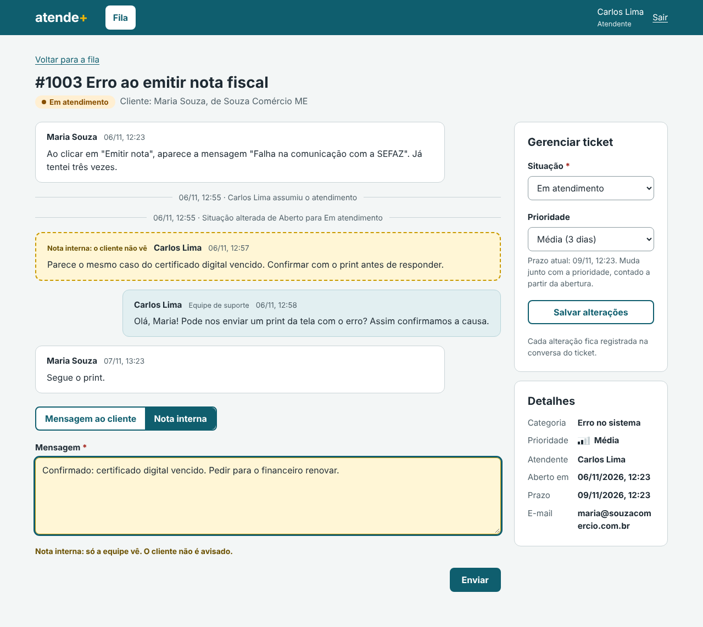
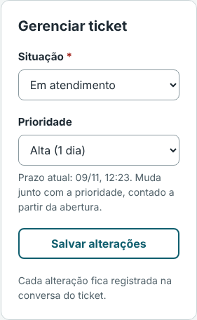
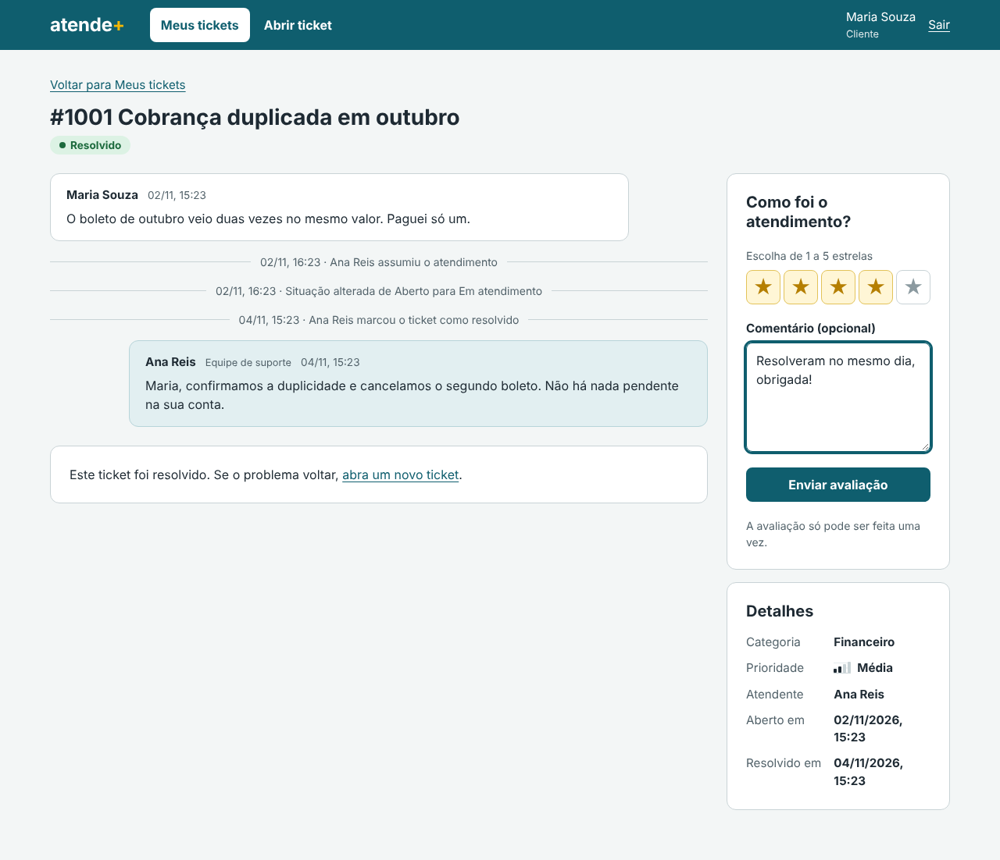
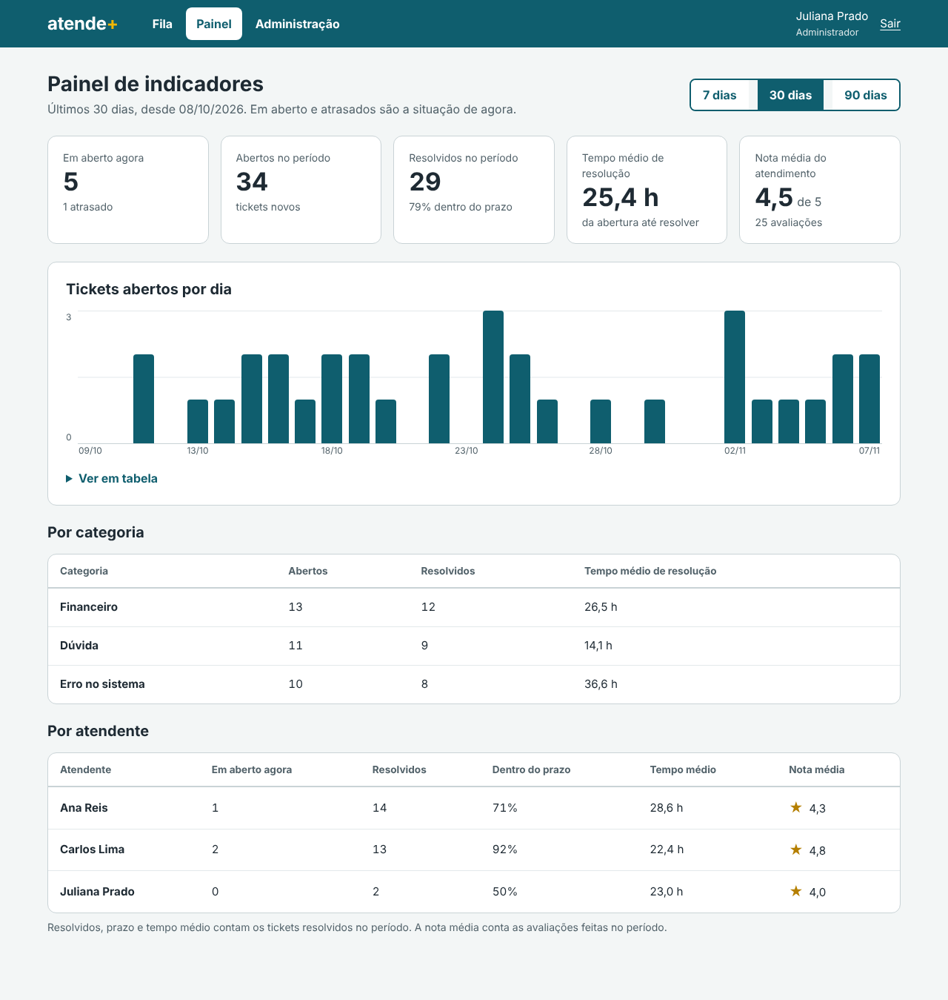

# Checkpoints 3 e 4 — Evolução do MVP

A versão **`v0.2.0`** acrescenta quatro funcionalidades ao MVP e serve para os checkpoints 3 e 4 juntos.
O foco foi o que mais agrega para quem usa o sistema todos os dias:
- a equipe conversa entre si sem expor o cliente;
- a prioridade reflete a urgência real;
- o cliente avalia o atendimento;
- a gestão acompanha os números.

| | v0.1.0 (MVP) | v0.2.0 |
| --- | --- | --- |
| Requisitos funcionais prontos | 11 de 21 | 15 de 21 |
| Testes automatizados | 111 | 139 |
| Telas | 9 | 10 (novo *Painel*) |
| Apps Django | 2 (`contas`, `tickets`) | 3 (novo `painel`) |

## 1. Funcionalidades implementadas

| # | Funcionalidade | Requisitos | Pull request |
| --- | --- | --- | --- |
| E1 | Notas internas | RF13 | [#13](https://github.com/natcurti/projeto_atende_mais/pull/13) |
| E2 | Mudar a prioridade, com o prazo recalculado | RF17, RN09 | [#14](https://github.com/natcurti/projeto_atende_mais/pull/14) |
| E3 | Avaliação do atendimento | RF16, RN11 | [#15](https://github.com/natcurti/projeto_atende_mais/pull/15) |
| E4 | Painel de indicadores | RF18 | [#16](https://github.com/natcurti/projeto_atende_mais/pull/16) |

### E1 — Notas internas (RF13)

Na tela do ticket, a equipe escolhe entre *Mensagem ao cliente* e *Nota interna*. Com a nota escolhida,
o campo fica amarelo e aparece o aviso de que só a equipe vê.

- **Qualquer pessoa da equipe** pode deixar uma nota, mesmo num ticket que está com outra pessoa ou ainda sem atendente. A nota não altera o ticket, então a RN05 não se aplica a ela; responder ao cliente continua restrito ao responsável e aos administradores.
- A nota **não muda a "última atualização"** que o cliente vê em *Meus tickets*. Senão o cliente perceberia um movimento que não consegue ver.



### E2 — Mudar a prioridade (RF17)

O painel *Gerenciar ticket* ganhou o campo *Prioridade*. Cada opção mostra o seu prazo ("Urgente (4 horas)") e a dica mostra o prazo atual.

- O prazo é **recalculado a partir da abertura** do ticket (RN09). Um ticket aberto há 6 horas que vira Urgente fica atrasado na hora e sobe para o topo da fila (RN10).
- O responsável ou um administrador muda a prioridade. O administrador também pode **triar tickets ainda abertos**, antes de alguém assumir.



### E3 — Avaliação do atendimento (RF16)

No ticket resolvido, a cliente dá de 1 a 5 estrelas e, se quiser, um comentário, **uma única vez** (RN11).
A equipe vê a avaliação nos detalhes do ticket.

As estrelas são botões de opção com aparência de estrela, feitos só com HTML e CSS: funcionam pelo teclado e com leitor de tela, sem JavaScript.



### E4 — Painel de indicadores (RF18)

Página só para administradores, com período de 7, 30 ou 90 dias:

| Indicador | Pergunta que responde |
| --- | --- |
| Em aberto agora e atrasados | Quanto trabalho a equipe tem neste momento? |
| Abertos no período | Quanto suporte os clientes estão pedindo? |
| Resolvidos e % dentro do prazo | A equipe está dando conta, e no tempo combinado? |
| Tempo médio de resolução | Quanto um cliente espera, em média? |
| Nota média | Os clientes estão satisfeitos? |
| Abertos por dia (gráfico) | Há dias de pico? |
| Por categoria (tabela) | Que tipo de problema mais aparece e qual demora mais? |
| Por atendente (tabela) | Como está a carga e o desempenho de cada pessoa? |

Decisões de visualização:
- **Cada gráfico mostra uma única medida**, então usa uma cor só, o petróleo da marca, sem legenda.
- **Comparações com várias medidas** por categoria ou por atendente ficam em **tabelas**, que comparam melhor do que vários gráficos.
- **Cada barra tem uma dica** ao passar o mouse ou ao navegar pelo teclado, e o gráfico tem a opção *Ver em tabela* para leitores de tela.
- **"Em aberto" e "atrasados" são a situação de agora.** Os demais indicadores contam o que aconteceu no período escolhido. Essa regra está escrita na própria tela.



No celular, os números de destaque ficam em duas colunas e o eixo do gráfico mostra só a primeira e a última data
([captura](imagens/05-painel-celular.png)).

## 2. Backlog atualizado

| Requisito | Prioridade (Entrega 1) | Situação |
| --- | --- | --- |
| RF01, RF02, RF04 a RF12 | Essencial | Pronto na v0.1.0 |
| RF13 Notas internas | Importante | Pronto na v0.2.0 |
| RF16 Avaliação | Importante | Pronto na v0.2.0 |
| RF17 Prioridade | Importante | Pronto na v0.2.0 |
| RF18 Painel de indicadores | Importante | Pronto na v0.2.0 |
| RF15 Reabrir ticket resolvido (e RN07, fechamento automático) | Importante | Backlog: trabalho futuro |
| RF20 Busca por número ou título | Importante | Backlog: trabalho futuro |
| RF03 Recuperar senha por e-mail | Desejável | Backlog: trabalho futuro |
| RF14 Anexos | Desejável | Backlog: trabalho futuro (a tabela já existe) |
| RF19 E-mail ao mudar a situação | Desejável | Backlog: trabalho futuro |
| RF21 Exportar CSV | Desejável | Backlog: trabalho futuro |

**Mudança de planejamento:** o Checkpoint 1 previa duas evoluções:
- Evolução 1: RF13, RF15, RF17 e RF20;
- Evolução 2: RF16 e RF18.

Para caber no prazo, elas viraram uma só, com as quatro funcionalidades de maior valor visível:
- notas internas e prioridade, para o atendimento do dia a dia;
- avaliação e painel, para a gestão.

RF15 e RF20 voltaram para o backlog. Eles não bloqueiam nenhum fluxo: hoje, se o problema volta, o cliente abre um novo ticket.

## 3. Análise de progresso

- **15 dos 21 requisitos funcionais prontos (71%)**: todos os 11 essenciais e 4 dos 6 importantes. Nenhum desejável ainda.
- **Todas as regras de negócio que dependem só dos dados** estão garantidas no banco e testadas. As que ficaram de fora dependem dos requisitos no backlog: RN07 (fechamento automático) e RN14 (anexos).
- **Qualidade:** 139 testes automatizados, todos passando. Cada funcionalidade nova trouxe os próprios testes:

| App | Testes |
| --- | --- |
| `contas` | 40 |
| `tickets` | 91 |
| `painel` | 8 |

- **Processo:** cada funcionalidade em uma branch e um pull request, com commits no padrão da Entrega 5. São 16 pull requests até aqui.

## 4. Problemas técnicos e decisões tomadas

| Situação | Decisão |
| --- | --- |
| **Notas internas e a RN05.** A regra diz que só o responsável altera o ticket. Uma nota de outro atendente seria proibida? | A nota não altera o ticket nem aparece para o cliente, então qualquer pessoa da equipe pode escrever. Responder ao cliente continua restrito. |
| **A nota interna mudava a "última atualização"** e reordenava a lista do cliente, revelando movimento. | Notas internas não atualizam esse campo. Há um teste para isso. |
| **Prazo ao mudar a prioridade:** contar a partir da abertura ou da mudança? | A partir da abertura, como diz a RN09. O prazo representa o compromisso com o cliente desde o pedido, e não reinicia com a mudança. |
| **Painel vazio na demonstração:** com 7 tickets de exemplo, os indicadores não diriam nada. | O comando de dados de exemplo gera 45 tickets de histórico com sorteio de semente fixa, então os números são os mesmos em qualquer máquina. Eles ficam com outros clientes, para não mudar o roteiro da Maria. |
| **Estrelas acessíveis** sem depender de JavaScript. | Botões de opção em ordem invertida no HTML e mostrados de 1 a 5 com CSS: a estrela escolhida e as anteriores acendem juntas, e o teclado funciona. |
| **Formulários antigos e campos novos.** Os testes do MVP enviavam o painel *Gerenciar ticket* sem o campo de prioridade, e a resposta sem o tipo de mensagem. | Os campos novos são opcionais e valem o valor atual quando não enviados. Assim, nenhum envio quebra. |
| **Teste com número esperado errado:** um ticket aberto há 10 dias e resolvido após 80 horas entra nos "resolvidos dos últimos 7 dias". | O teste estava errado, não o sistema. Fica o registro: os cálculos de período foram conferidos à mão com casos de borda. |

## 5. Como ver a nova versão

Recrie o banco para ter os dados novos (52 tickets):

```bash
# apague o arquivo db.sqlite3 e rode:
python manage.py migrate
python manage.py carregar_dados_exemplo
python manage.py runserver
```

| Quem | O que ver |
| --- | --- |
| Carlos (`carlos@empresa.com`) | No #1003, escrever uma nota interna e mudar a prioridade |
| Maria (`maria@souzacomercio.com.br`) | No #1001 (resolvido), avaliar com estrelas; no #1003, conferir que a nota não aparece |
| Juliana (`juliana@empresa.com`) | *Painel*, trocando entre 7, 30 e 90 dias; no #1005 (aberto), triar a prioridade |
