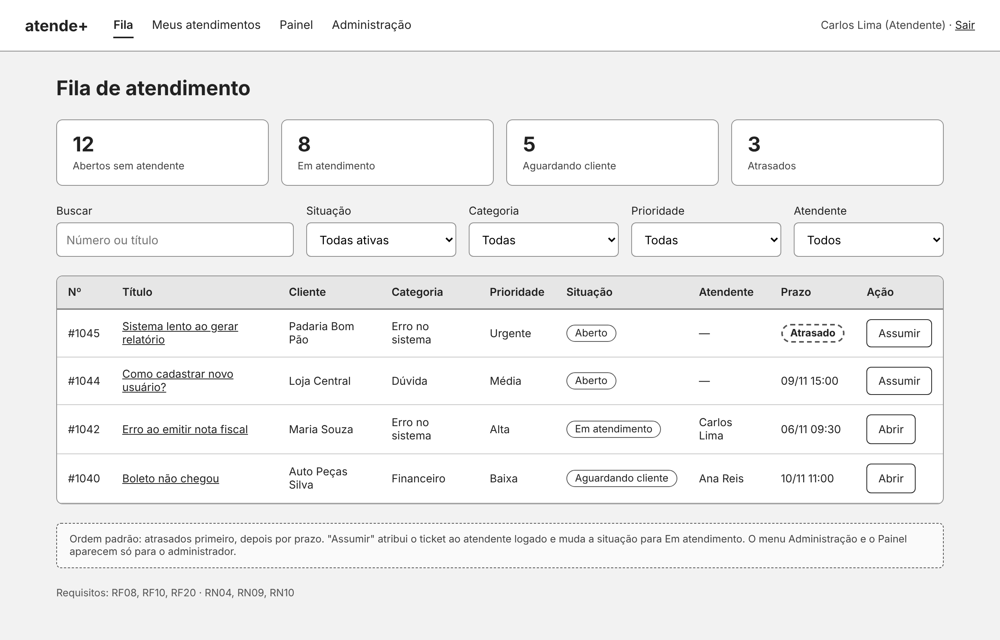
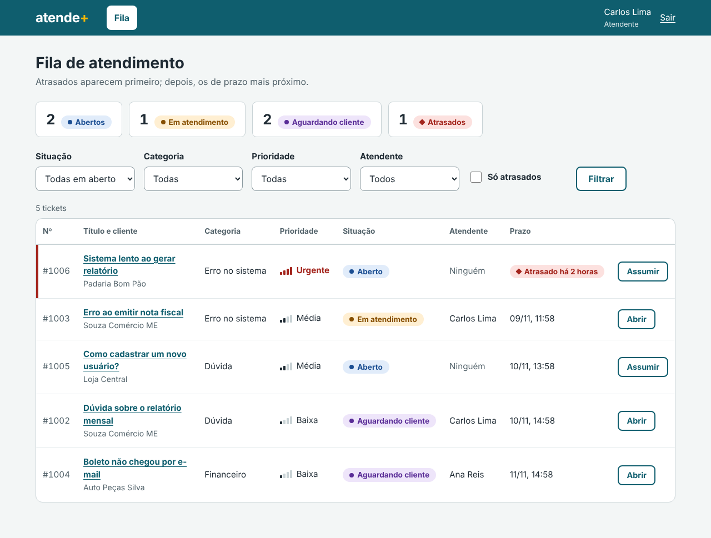
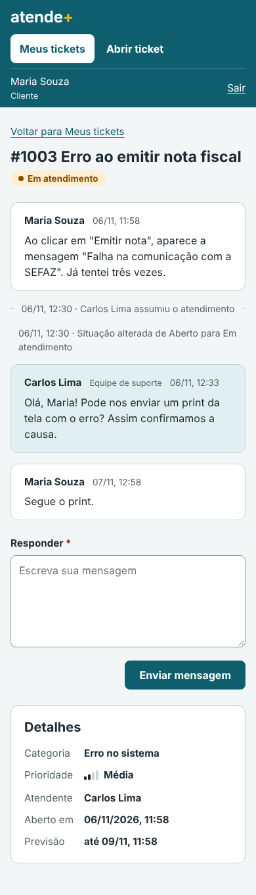
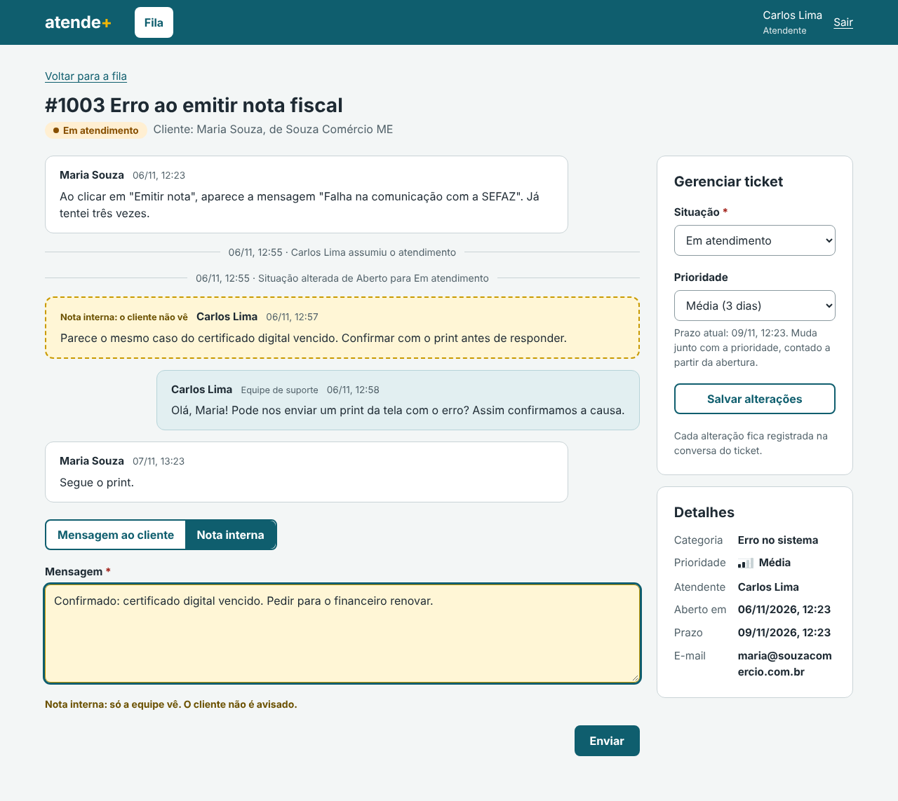
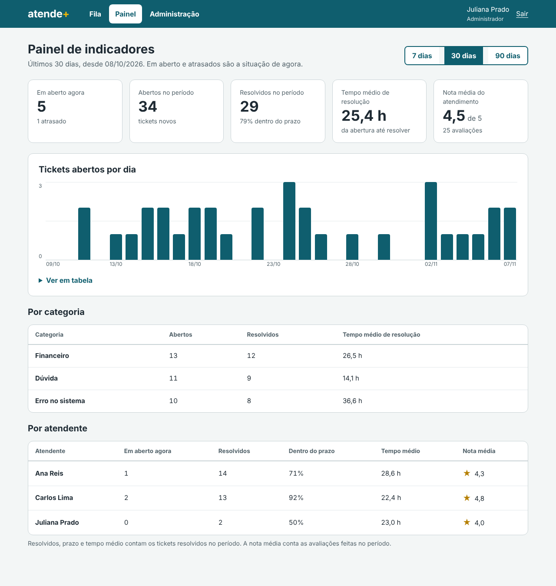
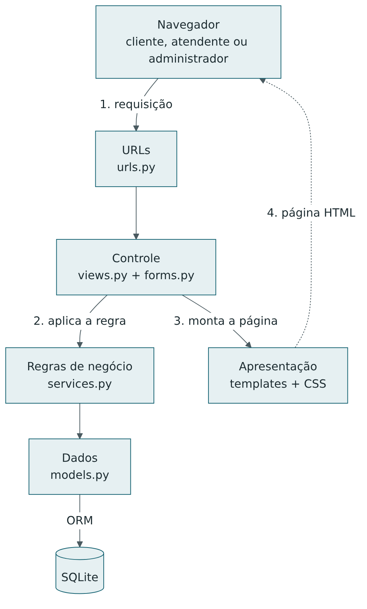
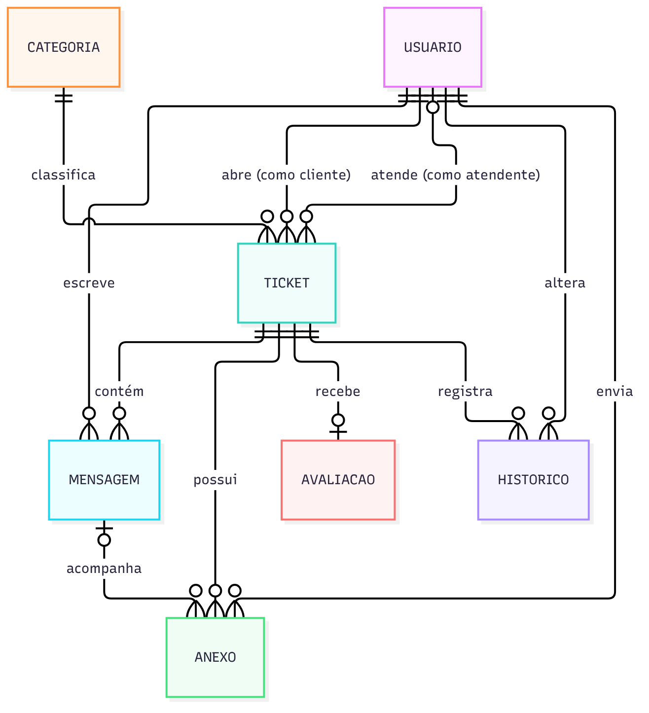

# atende+ — Relatório técnico

**Sistema web de tickets de suporte**

Versão para impressão: [relatorio-tecnico-atende-mais.pdf](relatorio-tecnico-atende-mais.pdf)

| | |
| --- | --- |
| Curso | Análise e Desenvolvimento de Sistemas — FATEC |
| Entrega | Entrega 9: relatório técnico |
| Autoria | Natália Curti, Mariana Ascencio e Gabriel Santos |
| Versão descrita | `v1.0.0` |
| Data | Novembro de 2026 |
| Sistema publicado | https://natcurti.pythonanywhere.com |
| Repositório | https://github.com/natcurti/projeto_atende_mais |
| Protótipo navegável | https://natcurti.github.io/projeto_atende_mais/03-ux-ui/prototipo/ |

## Resumo

O atende+ é um sistema web de tickets de suporte para pequenas empresas de software. Ele centraliza os pedidos de
ajuda dos clientes, define um responsável por cada pedido, registra toda a conversa e cada mudança, e mostra à gestão
indicadores do atendimento. Foi construído em Python com o framework Django e o banco SQLite. A arquitetura é MVT,
com uma camada de serviços que concentra as regras de negócio.

O desenvolvimento foi incremental, em três versões publicadas no GitHub:
- **`v0.1.0` (MVP):** cadastro e login, tickets do cliente, fila, atendimento e administração.
- **`v0.2.0`:** notas internas, prioridade com prazo, avaliação do atendimento e painel de indicadores.
- **`v1.0.0`:** correções da rodada de testes e publicação na internet.

A versão final atende 15 dos 21 requisitos funcionais levantados, entre eles todos os 11 essenciais, e 12 das 14 regras de negócio.
São 141 testes automatizados, com 96% de cobertura do código, e o sistema está publicado no PythonAnywhere.

**Palavras-chave:** sistema de tickets; suporte ao cliente; Django; desenvolvimento incremental; testes automatizados.

## 1. Introdução

### 1.1 Contexto e problema

A empresa fictícia que motivou o projeto vende um software de gestão e recebe pedidos de suporte por e-mail,
WhatsApp e telefone, sem registro único. O levantamento da [Entrega 1](../01-requisitos/) identificou cinco problemas:

| Problema | Consequência |
| --- | --- |
| Pedidos perdidos | Mensagens espalhadas por vários canais, algumas sem resposta |
| Falta de responsável | Ninguém sabe quem está cuidando do pedido, o que gera retrabalho ou abandono |
| Cliente sem retorno | O cliente não vê em que pé está o pedido e precisa cobrar de novo |
| Sem histórico | O próximo atendente começa do zero |
| Sem indicadores | A gestão não sabe o volume, os assuntos nem o tempo de resolução |

### 1.2 Objetivos

**Objetivo geral:** centralizar os pedidos de suporte num só lugar, com responsável, situação e histórico visíveis
para o cliente e para a equipe, e gerar indicadores simples para a gestão.

**Objetivos específicos:**
1. Permitir que o cliente abra e acompanhe os próprios tickets e converse com a equipe.
2. Organizar o trabalho da equipe numa fila priorizada pelo prazo, com um responsável por ticket.
3. Registrar automaticamente cada mudança de situação, de responsável e de prioridade.
4. Medir o atendimento: volume, tempo de resolução, cumprimento do prazo e satisfação.
5. Garantir que cada perfil acesse só o que é seu.

### 1.3 Público e perfis

| Perfil | Quem é | O que faz |
| --- | --- | --- |
| Cliente | Usuário do software que precisa de ajuda | Abre tickets, conversa com a equipe e avalia o atendimento |
| Atendente | Funcionário do suporte | Assume tickets, responde, muda a situação e a prioridade, deixa notas internas |
| Administrador | Coordenador do suporte | Faz o que o atendente faz, redistribui tickets, gerencia pessoas e categorias e consulta o painel |

## 2. Metodologia

### 2.1 Etapas

O projeto seguiu as 14 etapas da disciplina. Cada uma gerou um documento em `docs/` e, a partir da Entrega 6, código:

| Etapa | Entrega | Resultado |
| --- | --- | --- |
| 1 | Levantamento de requisitos | 21 requisitos funcionais, 10 não funcionais e 14 regras de negócio |
| 2 | Wireframes | 7 telas e o fluxo de navegação |
| 3 | UX/UI | Identidade visual e protótipo navegável em HTML e CSS |
| 4 | Banco de dados | Modelo entidade-relacionamento, modelo lógico e script SQL |
| 5 | Repositório e versionamento | Fluxo de branches, padrão de commits e modelo de pull request |
| 6 | Arquitetura | Camadas, padrões e esqueleto do projeto Django |
| 7 | Gerenciamento | Não realizada, por causa do prazo curto |
| 8 | Checkpoint 1 | Escopo do MVP e 27 critérios de aceite |
| 9 | Checkpoint 2 | MVP funcional (`v0.1.0`) |
| 10 e 11 | Checkpoints 3 e 4 | Evolução e nova versão (`v0.2.0`) |
| 12 | Entrega 8 | Plano de testes, execução e registro de bugs |
| 13 | Checkpoint 5 | Release candidate (`v1.0.0`) publicada |
| 14 | Entrega 9 | Este relatório |

### 2.2 Processo de desenvolvimento

O sistema foi construído em **incrementos pequenos**: uma funcionalidade por branch, com os testes dela, revisada
num pull request antes de entrar no código principal. As branches seguem o modelo da [Entrega 5](../05-repositorio/):

| Branch | Para que serve |
| --- | --- |
| `main` | Só versões entregues, cada uma marcada com uma tag (`v0.1.0`, `v0.2.0`, `v1.0.0`) |
| `develop` | Integra as funcionalidades prontas |
| `feature/…` e `docs/…` | Uma por tarefa |

Os commits seguem o padrão *Conventional Commits* em português, como `feat(tickets): …`, `fix(layout): …` e `docs: …`.
Ao todo, o repositório passou de 85 commits e 20 pull requests. Os commits e os pull requests foram centralizados na conta de uma integrante (@natcurti).

A priorização usou três níveis (Essencial, Importante, Desejável). O MVP reuniu os essenciais. As evoluções
escolheram os importantes de maior valor visível. Os desejáveis ficaram para trabalhos futuros.

### 2.3 Ferramentas

| Finalidade | Ferramenta |
| --- | --- |
| Linguagem e framework | Python 3.10 a 3.13, Django 5.2 LTS |
| Banco de dados | SQLite |
| Configuração por ambiente | python-dotenv (arquivo `.env`) |
| Interface | HTML, CSS próprio, fonte Atkinson Hyperlegible |
| Versionamento | Git e GitHub |
| Testes | Framework de testes do Django; coverage.py para medir a cobertura |
| Publicação | PythonAnywhere (sistema) e GitHub Pages (protótipo) |

## 3. Requisitos

O levantamento completo está na [Entrega 1](../01-requisitos/). Em resumo:

| Tipo | Total | Atendidos na `v1.0.0` |
| --- | --- | --- |
| Funcionais essenciais | 11 | 11 |
| Funcionais importantes | 6 | 4: notas internas, avaliação, prioridade e painel |
| Funcionais desejáveis | 4 | 0 |
| Regras de negócio | 14 | 12: as duas restantes dependem de requisitos do backlog |
| Não funcionais | 10 | 10. O RNF08 (navegadores) foi verificado no Chrome e no Edge; o Firefox está no roteiro manual |

As regras de negócio que mais moldaram o sistema:
- **RN05:** só o responsável ou um administrador altera um ticket.
- **RN08:** o cliente só vê os próprios tickets e nunca as notas internas.
- **RN09:** a prioridade define o prazo: Urgente 4 horas, Alta 1 dia, Média 3 dias e Baixa 5 dias.
- **RN10:** tickets atrasados aparecem primeiro.
- **RN13:** toda mudança fica no histórico.

## 4. Design e experiência do usuário

O design partiu dos [wireframes](../02-wireframes/) de baixa fidelidade, virou um
[protótipo navegável](https://natcurti.github.io/projeto_atende_mais/03-ux-ui/prototipo/) em HTML e CSS e, depois,
os templates do Django, que reaproveitam o mesmo CSS. O caminho da ideia até a tela pronta:

| Wireframe (Entrega 2) | Sistema (`v1.0.0`) |
| --- | --- |
|  |  |

Principais escolhas, detalhadas na [Entrega 3](../03-ux-ui/):

**Identidade visual:**
- O azul petróleo (`#0F5E6E`) é a cor principal, com contraste de 7,4:1 sobre o branco.
- O amarelo aparece só no "+" da marca e nas notas internas, como um post-it da equipe.
- A fonte é a Atkinson Hyperlegible, criada para máxima legibilidade, inclusive para pessoas com baixa visão.

**Informação que não depende só de cor:**
- Cada situação tem uma cor, mas o nome sempre aparece escrito.
- A prioridade é mostrada com barras e com o nome.
- O atraso tem um ícone e um texto, como "Atrasado há 2 horas".

**Responsividade:** no celular, as tabelas viram cartões e os menus se reorganizam. A largura mínima suportada é 360 px.

**Acessibilidade:**
- Tudo funciona pelo teclado, e o foco é sempre visível.
- As estrelas da avaliação são botões de opção feitos com HTML e CSS, sem JavaScript.
- O gráfico do painel tem uma versão em tabela.

**Heurísticas de Nielsen:** foram usadas para revisar as telas. Alguns exemplos:
- O sistema mostra a situação do ticket o tempo todo.
- Os erros dizem como corrigir.
- O sistema evita erros: quem não pode alterar um ticket nem vê o botão, e lê o motivo.

| Cliente no celular | Equipe: conversa com nota interna | Painel do administrador |
| --- | --- | --- |
|  |  |  |

## 5. Arquitetura

O sistema é um **monolito Django** com páginas montadas no servidor, no padrão **MVT (Model, View, Template)**.
Acima dele foi acrescentada uma camada de **serviços** ([Entrega 6](../06-arquitetura/)):

| Camada | Arquivos | Responsabilidade |
| --- | --- | --- |
| Apresentação | `templates/`, `static/` | Mostrar as telas, sem regra de negócio |
| Controle | `urls.py`, `views.py`, `forms.py` | Receber a requisição, validar a entrada, conferir o perfil e chamar a regra |
| Regras de negócio | `services.py` | As regras RN01 a RN14: assumir, mudar a situação, calcular o prazo, avaliar |
| Dados | `models.py` | Tabelas e restrições do banco |

O código está dividido em três apps:

| App | O que contém |
| --- | --- |
| `contas` | Usuários, perfis, login e administração da equipe |
| `tickets` | Tickets, conversa, fila, atendimento, categorias e avaliação |
| `painel` | Indicadores |

**A regra prática do projeto foi "views finas, regras em serviços".** Por exemplo, a view de mudar a situação não
decide nada: ela chama `services.mudar_situacao()`, que confere a permissão (RN05), valida a transição (RN02),
grava o histórico (RN13) e define as datas. Assim, a mesma regra vale para qualquer tela e é testada uma vez só.

As permissões por perfil são decoradores aplicados às views (`somente_cliente`, `somente_equipe`, `somente_administrador`).
O cliente que tenta abrir o ticket de outra pessoa recebe 404, e não 403, para nem confirmar que o ticket existe.

**Decisões principais:**

| Decisão | Alternativa | Motivo |
| --- | --- | --- |
| Monolito com páginas no servidor | API REST e front-end em React | Uma linguagem, um projeto e uma publicação; o protótipo virou template quase direto |
| Django | Flask, FastAPI | Já traz login, ORM, formulários, administração e testes |
| Django 5.2 LTS | Django mais novo | Suporte longo e compatível com mais versões do Python |
| SQLite | MariaDB, MySQL, PostgreSQL | Sem servidor para instalar: o professor e o PythonAnywhere rodam só com o Python |
| Usuário próprio com login por e-mail | Usuário padrão do Django | O sistema não tem "nome de usuário": todos entram pelo e-mail |

## 6. Banco de dados

São sete tabelas: `usuario`, `categoria`, `ticket`, `mensagem`, `anexo`, `historico` e `avaliacao`. O modelo está
na terceira forma normal, com uma exceção consciente: o nome da empresa fica como texto no usuário, porque o sistema
não gerencia empresas ([Entrega 4](../04-banco-de-dados/)).

**As regras de negócio que dependem só dos dados são garantidas pelo próprio banco**, com restrições `CHECK`,
`UNIQUE` e chaves estrangeiras. Assim, nem um erro no código consegue gravar um dado inválido:
- um ticket *Aberto* não pode ter atendente (RN03);
- um ticket *Em atendimento* precisa ter atendente (RN04);
- a nota da avaliação fica entre 1 e 5, com uma só avaliação por ticket (RN11);
- uma mensagem não pode ser vazia;
- um cliente precisa ter empresa.

Cada restrição tem uma mensagem de erro em português.

Outras decisões de modelagem:
- **Histórico separado das mensagens:** cada mudança guarda o campo, o valor anterior e o novo, o que permite gerar indicadores.
- **Prazo gravado no ticket:** a fila ordena por ele o tempo todo.
- **Nada é excluído:** pessoas e categorias são desativadas (RN12), e as chaves estrangeiras sem exclusão em cascata impedem apagar quem tem tickets.

A numeração dos tickets começa em #1000 (RN01).

## 7. Implementação

### 7.1 Versões

| Versão | Requisitos | O que entrega |
| --- | --- | --- |
| [`v0.1.0`](../09-mvp-funcional/) (MVP) | RF01, RF02, RF04 a RF12 | Cadastro e login; o cliente abre e acompanha tickets; fila com filtros e atrasados primeiro; assumir, responder e mudar a situação; administração de pessoas e categorias |
| [`v0.2.0`](../10-evolucao/) | RF13, RF16, RF17, RF18 | Notas internas; prioridade com prazo recalculado; avaliação de 1 a 5 estrelas; painel de indicadores |
| [`v1.0.0`](../12-release/) | — | Correções da rodada de testes, preparação para produção e publicação |

### 7.2 Pontos de destaque

- **Ciclo de vida do ticket:**
  - as transições permitidas entre as situações ficam numa tabela no código, e qualquer outra é recusada;
  - quando o cliente responde um ticket *Aguardando cliente*, ele volta sozinho para *Em atendimento* (RN06).
- **Linha do tempo:** a conversa mistura, em ordem, as mensagens e os eventos do histórico, como "Carlos Lima assumiu o atendimento". Para o cliente, as notas internas são filtradas antes de chegar à tela.
- **Fila:**
  - ordena atrasados primeiro e depois por prazo;
  - tem contadores por situação, cinco filtros combináveis e paginação;
  - o número de consultas ao banco não cresce com o tamanho da fila: são sempre 7, e há um teste que garante isso.
- **Painel:** os indicadores são calculados em `painel/services.py` para 7, 30 ou 90 dias:
  - tickets em aberto e atrasados;
  - abertos e resolvidos no período;
  - tempo médio de resolução;
  - percentual resolvido dentro do prazo;
  - nota média;
  - tickets abertos por dia, por categoria e por atendente.

  O gráfico de barras é feito só com HTML e CSS.
- **Dados de exemplo:** o comando `python manage.py carregar_dados_exemplo` cria o cenário da demonstração:
  - 8 pessoas e 4 categorias;
  - 7 tickets com histórico;
  - 45 tickets antigos para o painel, sorteados com semente fixa, então os números são os mesmos em qualquer máquina.

**Tamanho do código:** cerca de 2.400 linhas de Python na aplicação e 1.250 linhas de testes, além de 830 linhas
de templates e 660 de CSS.

## 8. Testes e qualidade

A estratégia está na [Entrega 8](../11-testes/). Os testes automatizados cobrem três níveis:
- **unidade:** regras isoladas e restrições do banco;
- **integração:** formulário, regra e banco juntos, pelo cliente de teste do Django;
- **casos negativos e de segurança:** perfil errado, dados alterados no envio, código malicioso digitado num campo e falta do código CSRF.

Uma rodada manual completa verificou o layout, o teclado, o celular e as páginas de erro em modo de produção.

| Indicador | Resultado |
| --- | --- |
| Testes automatizados | 141, todos passando |
| Cobertura do código | 96% (`contas` 98%, `tickets` 95%, `painel` 100%) |
| Casos de teste documentados | 33 ligados aos requisitos, 9 manuais e 13 para a apresentação (no README) |
| Desempenho com 1.100 tickets | Fila em 10 ms, Meus tickets em 97 ms, painel de 90 dias em 15 ms (limite do RNF07: 2 s) |
| Defeitos registrados | 12, todos corrigidos |

Os três defeitos mais graves foram pegos pelos testes automatizados antes de chegarem a uma versão:
- uma regressão nos formulários antigos;
- uma importação circular;
- uma falha ao repassar tickets.

Os três encontrados na rodada final vieram de testes com entradas extremas de propósito:
- textos sem limite de tamanho;
- palavras longas estourando a tela;
- um botão cortado na fila.

## 9. Publicação

O sistema está publicado no plano gratuito do **PythonAnywhere**, em https://natcurti.pythonanywhere.com, com HTTPS.

O mesmo código roda na máquina de quem desenvolve e no servidor. O que muda fica no arquivo `.env`, que não vai para o repositório:
- o modo de depuração;
- a chave secreta;
- os endereços permitidos.

Em produção:
- os cookies de sessão só trafegam por HTTPS;
- os erros mostram páginas próprias, sem detalhes técnicos;
- o sistema se recusa a iniciar se alguém esquecer de trocar a chave de desenvolvimento.

A verificação de segurança do Django para servidores (`check --deploy`) passa sem avisos. O passo a passo da
publicação e da atualização está na [Checkpoint 5](../12-release/).

## 10. Resultados

Como cada problema levantado na Entrega 1 foi resolvido:

| Problema | Como o atende+ resolve |
| --- | --- |
| Pedidos perdidos | Todo pedido vira um ticket numerado, numa fila única que mostra primeiro os atrasados |
| Falta de responsável | Cada ticket tem no máximo um responsável, e só ele ou um administrador o altera |
| Cliente sem retorno | O cliente vê a situação e a conversa a qualquer momento, e é avisado dos tickets que esperam resposta dele |
| Sem histórico | A conversa e cada mudança ficam registradas com autor e data; notas internas guardam o raciocínio da equipe |
| Sem indicadores | O painel mostra volume, tempo de resolução, cumprimento do prazo e satisfação, por categoria e por atendente |

**Em números:**
- 15 requisitos funcionais (71%), entre eles todos os essenciais;
- 12 de 14 regras de negócio;
- os 10 requisitos não funcionais, com o Firefox ainda no roteiro manual;
- 10 telas;
- 3 versões;
- 141 testes;
- nenhum defeito aberto.

## 11. Dificuldades e lições aprendidas

| Dificuldade | Como foi resolvida | Lição |
| --- | --- | --- |
| Escolha do banco: a ideia inicial era MariaDB, sem servidor disponível na máquina de desenvolvimento nem no plano gratuito de publicação | SQLite como banco oficial, com o script SQL também testado em MariaDB | A melhor tecnologia é a que roda onde o sistema precisa rodar, e no Django trocar de banco é só configuração |
| O SQLite só ignora maiúsculas em letras sem acento, então "Dúvida" e "DÚVIDA" viravam categorias diferentes | Comparação feita no Python | Testar com dados reais da língua, com acentos, e não só com exemplos em ASCII |
| Regras que parecem simples ficaram ambíguas na prática. Por exemplo: um atendente que não é o responsável pode deixar uma nota interna? | Decidir pelo objetivo da regra e registrar a decisão: a nota não altera o ticket, então pode | Requisito escrito não substitui decisão documentada |
| Campos novos quebraram envios antigos | Os testes do MVP apontaram na hora | A suíte de testes é o que permite evoluir sem medo |
| Layout perfeito com dados de exemplo, mas quebrado com entradas extremas | Teste exploratório com textos longos e caracteres especiais | Os dados de exemplo mostram o caso feliz; os defeitos aparecem nas bordas |
| Prazo curto para todas as etapas | MVP enxuto, duas evoluções unidas numa versão, e a Entrega 7 não foi feita | Priorizar por valor (Essencial, Importante, Desejável) torna os cortes fáceis de justificar |

## 12. Trabalhos futuros

| Item | Requisito | Observação |
| --- | --- | --- |
| Reabrir ticket resolvido em até 7 dias e fechamento automático | RF15, RN07 | Próximo da fila: completa o ciclo de vida |
| Busca por número ou palavra do título | RF20 | Útil quando o volume crescer |
| Recuperar senha por e-mail | RF03 | Exige um serviço de envio de e-mail |
| Anexos (JPG, PNG e PDF de até 5 MB) | RF14, RN14 | A tabela `anexo` já existe |
| E-mail ao cliente quando a situação muda | RF19 | Mesmo serviço de e-mail do RF03 |
| Exportar a fila filtrada em CSV | RF21 | Reaproveita os filtros da fila |
| Fila em tablets | — | Entre 641 px e cerca de 1.100 px, a tabela rola para o lado; um layout intermediário melhoraria |
| Banco PostgreSQL | — | Só se o volume passar do que o SQLite atende bem; é uma troca de configuração |

## 13. Conclusão

O atende+ cumpriu o objetivo geral: os pedidos de suporte ficam num só lugar, com responsável, situação e histórico
visíveis para cliente e equipe, e a gestão tem indicadores para acompanhar o atendimento.

O projeto percorreu todas as fases de um sistema real:
- levantamento de requisitos e design da experiência;
- modelagem do banco e arquitetura;
- implementação incremental em versões;
- testes e publicação na internet.

Três escolhas sustentaram a qualidade:
- **Regras de negócio** concentradas numa camada de serviços e reforçadas por restrições no banco.
- **Testes automatizados** escritos junto com cada funcionalidade.
- **Fluxo de versionamento** com branches e pull requests.

O resultado é um sistema pequeno, mas completo, correto nas regras que importam, acessível e fácil de evoluir:
o backlog de trabalhos futuros pode ser construído sobre a mesma base, sem retrabalho.

## Referências

- BRAILLE INSTITUTE OF AMERICA. **Atkinson Hyperlegible Font**. Disponível em: https://www.brailleinstitute.org/freefont. Acesso em: 7 nov. 2026.
- CONVENTIONAL COMMITS. **Conventional Commits 1.0.0**. Disponível em: https://www.conventionalcommits.org/pt-br/v1.0.0/. Acesso em: 7 nov. 2026.
- DJANGO SOFTWARE FOUNDATION. **Django documentation, versão 5.2**. Disponível em: https://docs.djangoproject.com/pt-br/5.2/. Acesso em: 7 nov. 2026.
- DRIESSEN, V. **A successful Git branching model**. 2010. Disponível em: https://nvie.com/posts/a-successful-git-branching-model/. Acesso em: 7 nov. 2026.
- NIELSEN, J. **10 Usability Heuristics for User Interface Design**. Nielsen Norman Group, 1994, atualizado em 2024. Disponível em: https://www.nngroup.com/articles/ten-usability-heuristics/. Acesso em: 7 nov. 2026.
- PYTHONANYWHERE. **Deploying an existing Django project on PythonAnywhere**. Disponível em: https://help.pythonanywhere.com/pages/DeployExistingDjangoProject/. Acesso em: 7 nov. 2026.
- SQLITE. **SQLite documentation**. Disponível em: https://www.sqlite.org/docs.html. Acesso em: 7 nov. 2026.
- W3C. **Web Content Accessibility Guidelines (WCAG) 2.2**. 2023. Disponível em: https://www.w3.org/TR/WCAG22/. Acesso em: 7 nov. 2026.
